# Laporan Praktikum Minggu 3: Navigation & State Management
> **Mata Kuliah:** Pemrograman Mobile | **Semester:** 5

---

### Identitas Mahasiswa
| Data | Keterangan |
| :--- | :--- |
| **Nama Lengkap** | Bintang Pancahaya P |
| **NIM** | 244107020115 |
| **Kelas** | TI-3F |
| **Program Studi** | D-IV Teknik Informatika |
| **Jurusan** | Teknologi Informasi |
| **Institusi** | Politeknik Negeri Malang |

Proyek: `week3_navigation/` (Praktikum 1) dan `week3_todo/` (Praktikum 2, 3, AI Challenge, dan mini project) - aplikasi ToDo dengan **GoRouter** dan **Riverpod**. Dijalankan dengan `flutter run` lalu memilih **Chrome**.

### Stack Teknologi
| Teknologi | Kegunaan |
| :--- | :--- |
| Flutter 3.47 / Dart 3.13 | Framework UI |
| `flutter_riverpod` ^3.4 | State management (`Notifier`, `AsyncNotifier`, provider turunan) |
| `go_router` ^18.1 | Navigasi deklaratif, path parameter, `StatefulShellRoute` |
| `flutter_test` | Unit test dan widget test |

---

## Praktikum 1: Navigasi dengan GoRouter

Halaman utama (`/`) berisi daftar item. Saat item diklik, aplikasi berpindah ke `/detail/:id`, dan ID diambil dari `state.pathParameters`.

### Tangkapan Layar Hasil Praktikum
| Home | Detail |
| :---: | :---: |
| 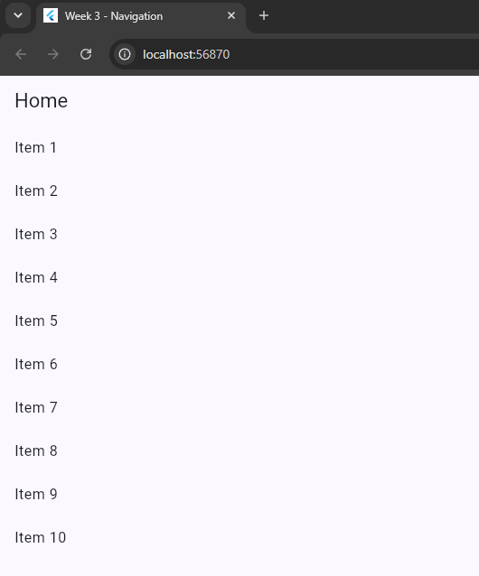 | 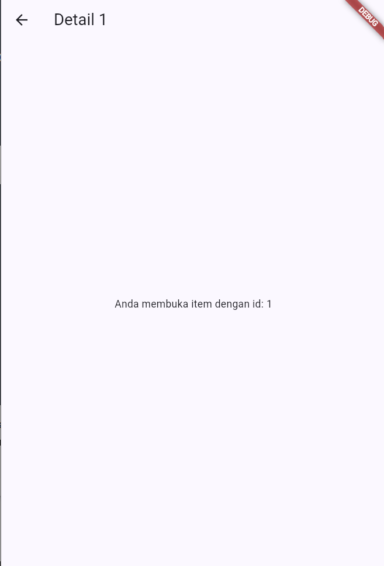 |

---

## Praktikum 2: Aplikasi ToDo dengan Riverpod

`TodoListNotifier` (`Notifier<List<Todo>>`) mengelola daftar tugas secara immutable (selalu membuat list baru). UI memakai `ConsumerWidget`: `ref.watch` di `build()` dan `ref.read(todoListProvider.notifier)` di callback.

### Tangkapan Layar Hasil Praktikum
| Kosong | Dialog Tambah | Daftar Terisi |
| :---: | :---: | :---: |
| 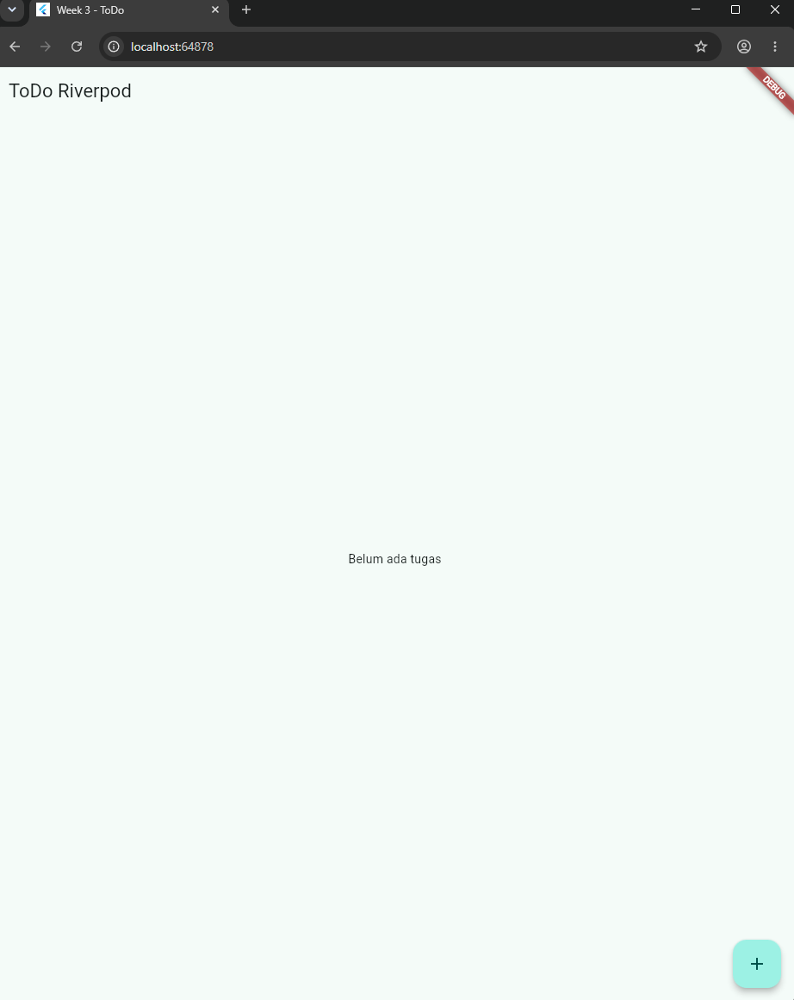 | 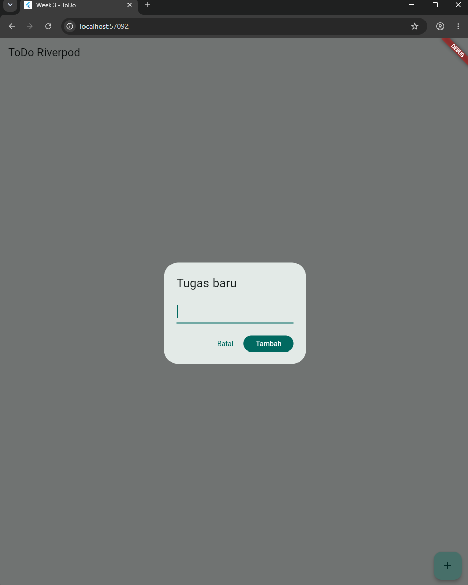 | 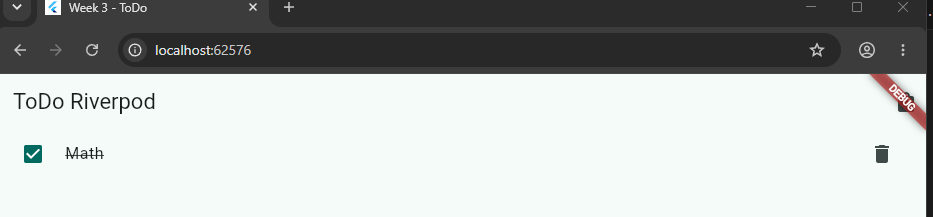 |

---

## Praktikum 3: AsyncValue (Loading, Error, Success)

`ProductsNotifier` (`AsyncNotifier<List<String>>`) mensimulasikan network 2 detik. UI memakai `productsAsync.when(loading:, error:, data:)`, dan tombol **Coba lagi** memanggil `ref.invalidate(productsProvider)`.

### Tangkapan Layar Hasil Praktikum
| Loading | Error | Success |
| :---: | :---: | :---: |
| 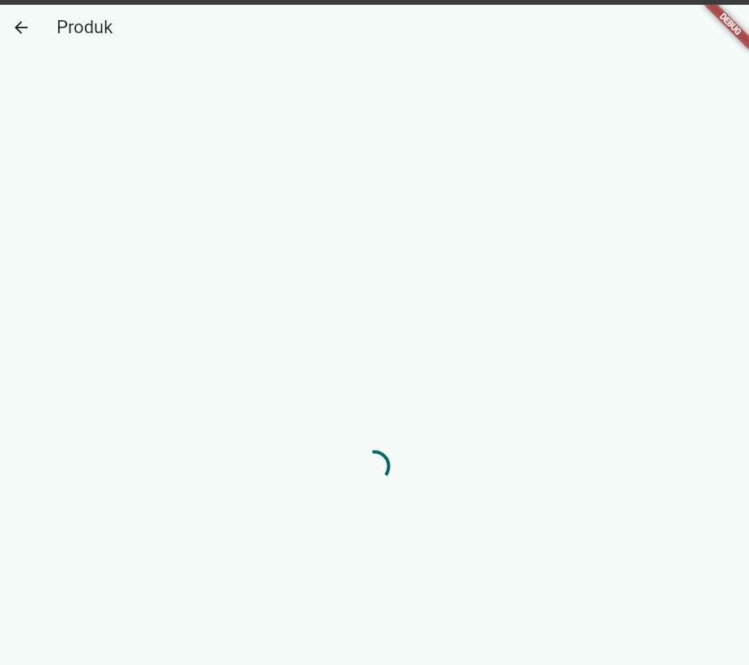 | 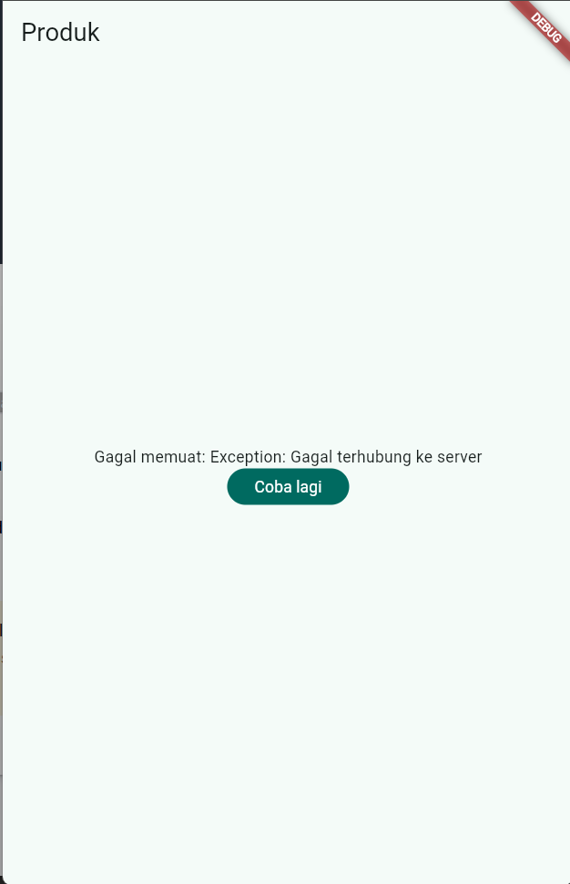 | 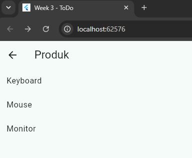 |

> **Catatan Riverpod 3:** provider yang error otomatis di-retry dengan exponential backoff sehingga UI tertahan di loading cukup lama. Retry otomatis dimatikan dengan `retry: (retryCount, error) => null`.

**Refleksi: mengapa menampilkan data lama (stale data) dengan indikator refresh kadang lebih baik daripada mengosongkan layar?** Pengguna tetap bisa membaca dan memakai data, tidak ada layar kosong yang "berkedip" setiap refresh, dan bila refresh gagal (mis. offline) data terakhir masih berguna. Pola ini penting untuk pull-to-refresh pada feed, daftar yang sering dibuka ulang (inbox, ToDo, saldo), dan data berkala (dashboard, harga).

---

## AI Prompt Challenge

```text
Buatkan halaman Flutter bernama StatsPage menggunakan flutter_riverpod.
Requirements:
- ConsumerWidget dengan satu AsyncNotifierProvider yang mensimulasikan
  pengambilan data statistik (delay 2 detik, kadang gagal 30%).
- UI harus menangani loading (spinner), error (pesan + tombol retry),
  dan success (ListView 3 item).
- Berikan unit test untuk notifier-nya.
Jelaskan setiap bagian kode dalam komentar.
```

### Hasil AI Prompt Challenge
| Berkas | Peran |
| :--- | :--- |
| `week3_todo/lib/providers/stats_provider.dart` | `StatsNotifier` (`AsyncNotifier<TodoStats>`): delay 2 detik, gagal 30% (`StatsException`), data dari `todoStatsProvider`; `statsDelayProvider` & `statsRandomProvider` agar bisa diuji |
| `week3_todo/lib/pages/stats_page.dart` | `StatsPage` (`ConsumerWidget`): spinner, pesan error + **Coba lagi**, dan success berupa progres + `ListView` 3 item |
| `week3_todo/test/stats_test.dart` | 5 unit test notifier + 2 widget test StatsPage |
| `docs/ai_challenge.md` | Prompt, output awal AI, checklist verifikasi, perbaikan, dan hasil testing |

`StatsPage` dipasang di rute `/stats` (tab **Statistik** pada NavigationBar).

### Tangkapan Layar Hasil AI Challenge
| Loading (Spinner) | Error (Pesan + Coba lagi) | Success (ListView 3 Item) |
| :---: | :---: | :---: |
| 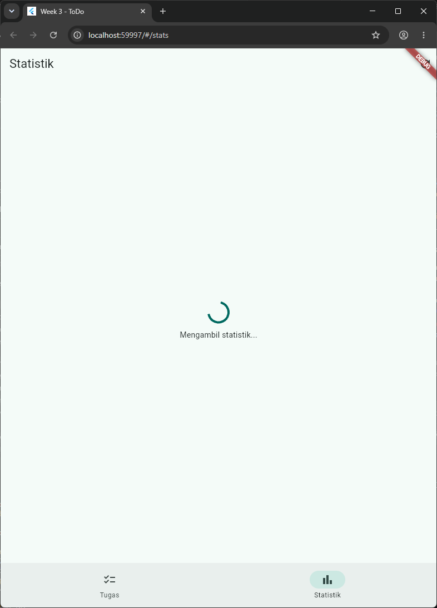 | 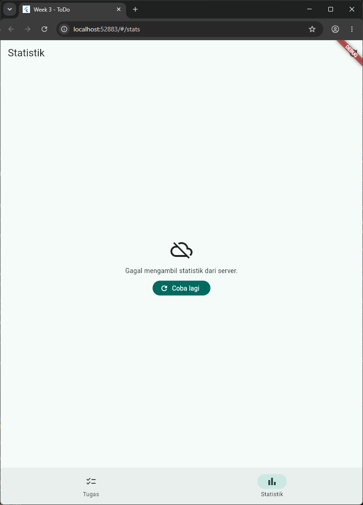 | 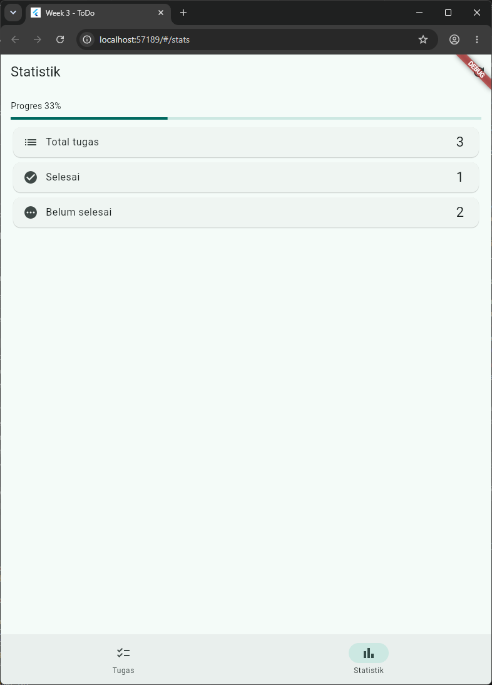 |
| *"Mengambil statistik..." selama delay* | *"Gagal mengambil statistik dari server." + tombol Coba lagi* | *Progres 33% + Total 3, Selesai 1, Belum selesai 2* |

---

## Refactoring Challenge

### Poin-Poin Refactoring Kode
1. **`TodoTile` tersendiri** (`week3_todo/lib/widgets/todo_tile.dart`): menerima `todo`, `onToggle`, `onDelete`, `onTap`; tidak bergantung pada Riverpod sehingga bisa diuji sendiri dan `build()` `TodoPage` lebih pendek.
2. **Provider turunan untuk filter**: `filteredTodoListProvider` membaca `todoListProvider` + `todoFilterProvider` (Semua / Aktif / Selesai). Statistik juga provider turunan `todoStatsProvider`, yang kini dipakai ulang oleh `StatsNotifier`.
3. **GoRouter + NavigationBar**: `StatefulShellRoute.indexedStack` dengan branch `/` (daftar) dan `/stats` (statistik). Halaman detail `/todo/:id` dan `/products` berada di luar shell (tampil penuh).
4. **Id unik untuk `Todo`**: `toggle`/`remove` sebelumnya memakai index, padahal index di list terfilter berbeda dengan list asli; kini memakai `id`.
5. **Kepatuhan linter**: `flutter analyze` -> **No issues found!**

---

## Mini Project: Aplikasi ToDo dengan Navigasi dan Riverpod

| Syarat | Implementasi |
| :--- | :--- |
| Minimal 2 halaman dengan GoRouter | `/` daftar, `/stats` statistik, `/todo/:id` detail, `/products` produk (`week3_todo/lib/router.dart`) |
| State dikelola Riverpod (`Notifier`), UI `ConsumerWidget` | `TodoListNotifier`, `TodoFilterNotifier`; semua halaman `ConsumerWidget` |
| Simulasi asinkron dengan `AsyncValue` | `StatsNotifier` (AI Challenge) dan `ProductsNotifier`: loading, error, success |
| Minimal 1 unit/widget test lulus | 18 test lulus |
| AI Challenge didokumentasikan | `docs/ai_challenge.md` |

### Tangkapan Layar Mini Project
| Daftar Tugas + Filter | Detail Tugas (`/todo/:id`) | Statistik (`/stats`) |
| :---: | :---: | :---: |
| 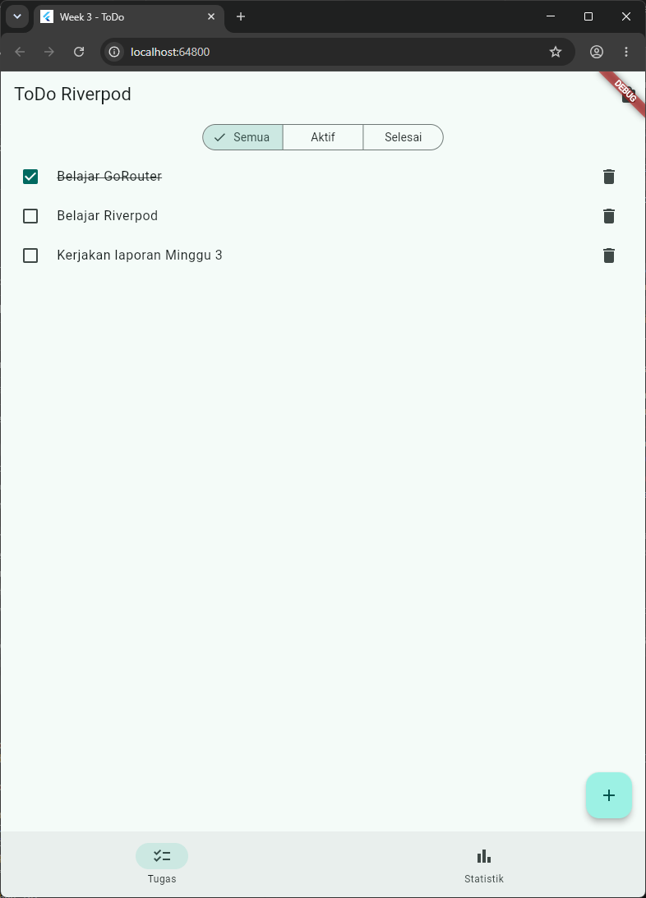 | 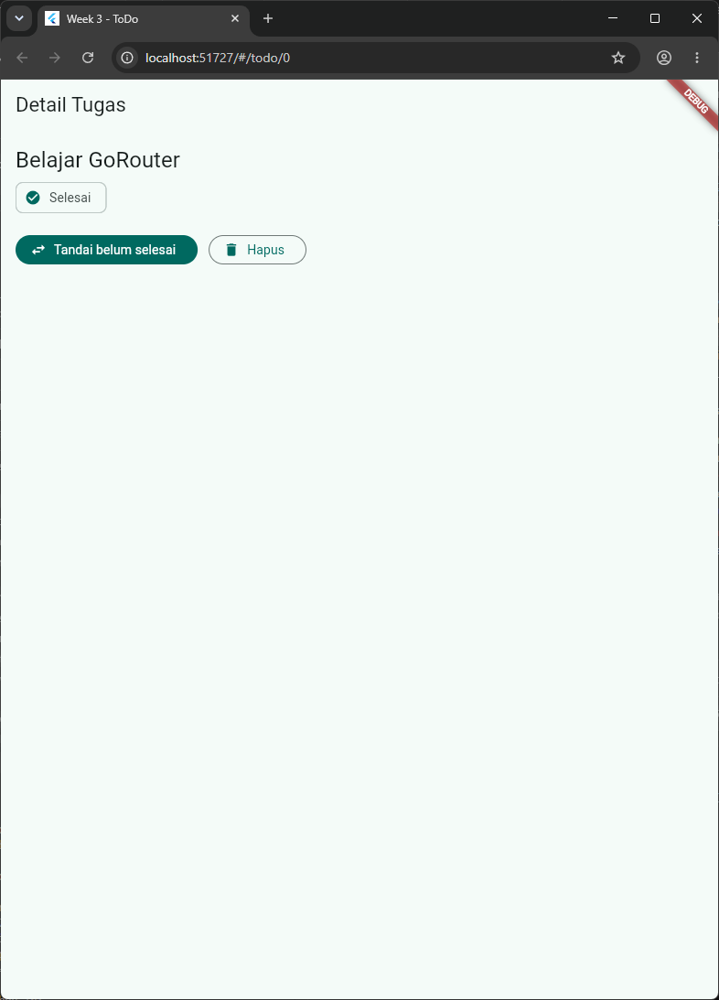 |  |
| *3 tugas, satu selesai (dicoret), filter Semua/Aktif/Selesai, NavigationBar* | *Status Selesai, tombol tandai dan hapus* | *Statistik dari state ToDo yang sama* |

> Catatan pengambilan screenshot: Chrome tidak bisa diklik karena komputer dikendalikan dari jarak jauh. Screenshot mini project dan AI Challenge diambil lewat `week3_todo/lib/screenshot_main.dart` (`flutter run -t lib/screenshot_main.dart --dart-define=SCENE=...`), yang mengisi tugas memakai `TodoListNotifier` asli dan memakai override provider simulasi yang sama dengan unit test (delay/acak) untuk memunculkan state loading, error, dan success.

---

## Pengujian Kode (Testing)

| File | Test |
| :--- | :--- |
| `week3_todo/test/unit_test.dart` (6) | `TodoListNotifier` awalnya kosong; add/toggle/remove berdasarkan id; state baru adalah list baru (immutable); `filteredTodoListProvider` mengikuti filter; `todoStatsProvider` menghitung total/selesai/progres; `productsProvider` berakhir di `AsyncData` |
| `week3_todo/test/widget_test.dart` (5) | Test modul "menambah tugas baru"; alur detail -> filter -> statistik (progres 50%); `TodoTile` memanggil callback; `ProductPage` loading -> success; `ProductPage` error -> Coba lagi |
| `week3_todo/test/stats_test.dart` (7) | `StatsNotifier`: sukses, gagal -> `AsyncError`, batas 30%, retry -> sukses, diambil ulang saat daftar berubah; `StatsPage`: loading -> ListView 3 item, error -> Coba lagi -> sukses |

Hasil: **18/18 test lolos**.

| Hasil `flutter analyze` dan `flutter test` |
| :---: |
| 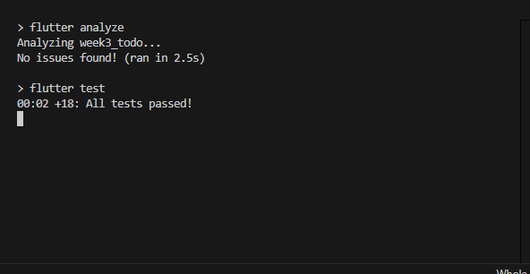 |

---

## Checklist Verifikasi Praktikum

- [x] Navigasi GoRouter bekerja: pindah halaman, back, dan akses path detail langsung (`/todo/:id`).
- [x] `ProviderScope` membungkus root aplikasi; state ToDo bertahan saat berpindah halaman atau tab.
- [x] UI `AsyncValue` menangani loading, error, dan success, bukan hanya success.
- [x] `flutter analyze` tanpa issue dan semua test lulus.
- [x] Hasil AI diverifikasi dan didokumentasikan pada folder `docs/`.

---

## Eksplorasi AI Prompt Challenge

| No | Poin Pemeriksaan | Hasil | Temuan & Perbaikan |
| :-: | :--- | :-: | :--- |
| 1 | State diubah immutable? | Lolos | Tidak ada mutasi list; state hanya diganti lewat `AsyncValue`. |
| 2 | `ref.watch` di `build`, `ref.read` di callback? | **Diperbaiki** | Draf memanggil `build()` manual di `retry()`; diganti `ref.invalidate(statsProvider)`. Semua `ref.watch` diletakkan sebelum `await`. |
| 3 | Ketiga state AsyncValue ditangani? | **Diperbaiki** | Auto-retry Riverpod 3 menahan loading -> `retry: null`; spinner tidak muncul saat retry -> `skipLoadingOnRefresh: false`. |
| 4 | Provider bertipe eksplisit dan tidak duplikat? | **Diperbaiki** | Draf memakai data statistik hardcode yang menduplikasi `todoStatsProvider`; kini `StatsNotifier` membaca `todoStatsProvider`. |
| 5 | Memakai API Riverpod lama? | Lolos | Sudah `AsyncNotifier` + `ConsumerWidget`, tanpa `StateProvider`/`StateNotifierProvider`. |
| 6 | `flutter analyze` & `flutter test` lolos? | **Diperbaiki** | Test draf bergantung `Random()` (gagal ~30% run) dan menunggu 2 detik; kini acak & delay diinjeksi lewat provider. Hasil: No issues found, 18/18 lolos. |

Detail lengkap (output awal AI dan alasan keputusan): `docs/ai_challenge.md`.

---

## Refleksi Pembelajaran

### 1. Kapan `setState` masih cukup, dan kapan state harus naik ke Riverpod?
`setState` cukup untuk state lokal dan sementara di satu widget, misalnya teks form, tampil/sembunyikan password, atau animasi sederhana. State perlu naik ke Riverpod bila dipakai beberapa halaman (daftar tugas dipakai `/`, `/todo/:id`, dan `/stats`), harus bertahan walau widget di-dispose, berisi logika bisnis yang perlu diuji tanpa UI, atau berasal dari sumber asinkron.

### 2. Apa perbedaan `context.go` dan `context.push`?
`context.go('/path')` mengganti stack navigasi sesuai URL tujuan, cocok untuk pindah tab, redirect login/logout, dan deep link. `context.push('/path')` menumpuk halaman baru sehingga back kembali ke halaman sebelumnya, cocok untuk detail, form, atau alur yang bisa dibatalkan. Di aplikasi ini detail tugas dan produk dibuka dengan `push`, sedangkan tab memakai `goBranch`.

### 3. Bagaimana `AsyncValue` mencegah bug dibanding tiga boolean terpisah?
Dengan `isLoading`, `hasError`, dan `data` terpisah, kombinasi mustahil bisa terjadi (loading sekaligus error, atau error lupa di-reset). `AsyncValue` adalah satu nilai dengan tiga bentuk (`AsyncLoading`, `AsyncError`, `AsyncData`); exception di `build()` otomatis menjadi `AsyncError`, dan `.when()` mewajibkan ketiga kasus ditangani sehingga UI error tidak terlupa.

### 4. Bagian mana dari hasil AI yang diperbaiki, dan mengapa?
Yang paling penting: (1) statistik hardcode diganti data dari `todoStatsProvider` agar angka selalu cocok dengan daftar tugas; (2) `Random()` dan delay diinjeksi lewat provider karena tanpa itu unit test tidak deterministik; (3) perilaku Riverpod 3 (auto-retry dan error lama saat refresh) disesuaikan agar state loading/error benar-benar terlihat. Masalah nomor 2 dan 3 tidak terlihat dari membaca kode saja, baru ketahuan saat menulis dan menjalankan test.

---

## Cara Menjalankan Aplikasi
```bash
cd 03-week-3-navigation-state-management/week3_todo
flutter pub get
flutter run        # pilih [2] Chrome
flutter analyze
flutter test
```
