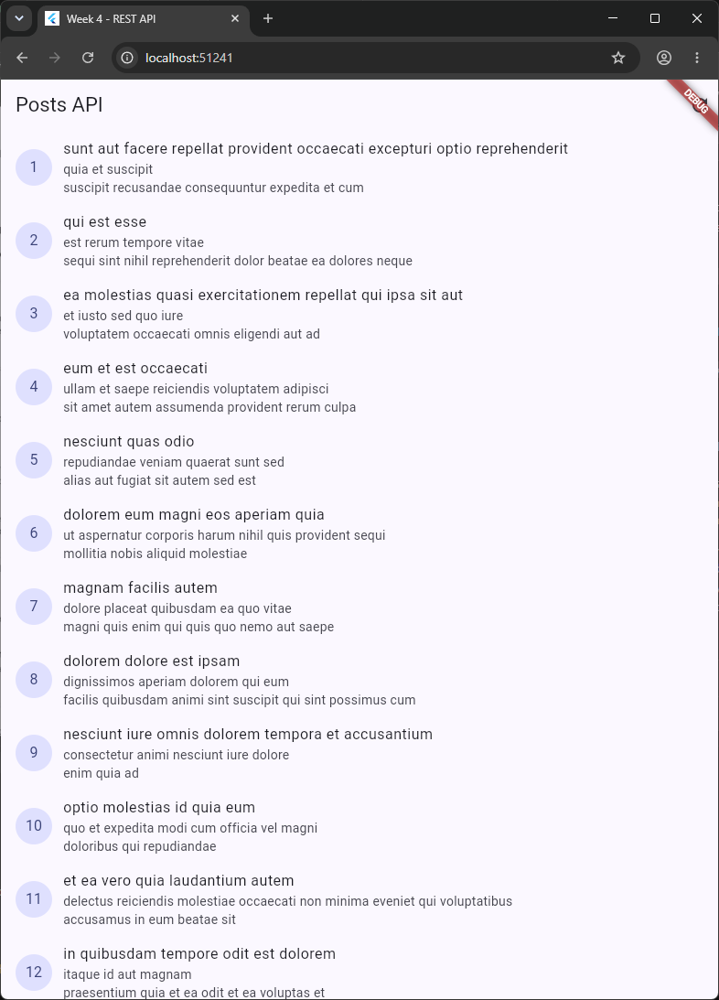
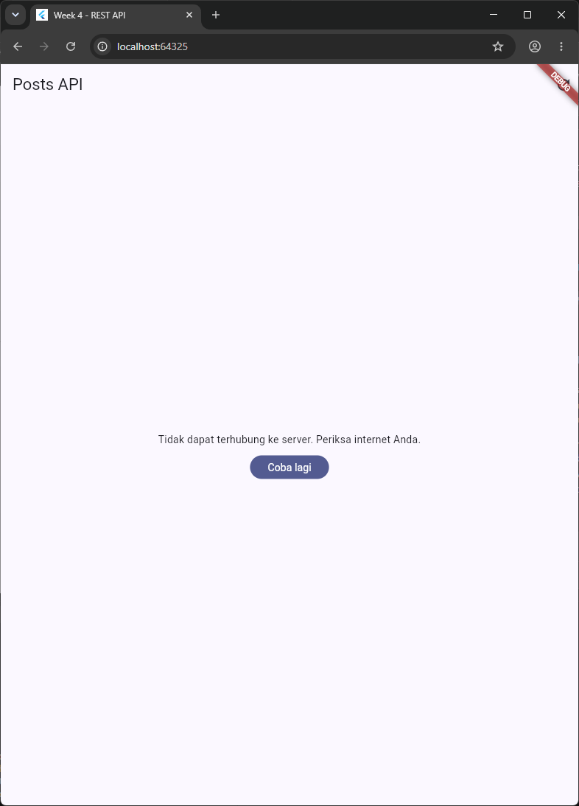
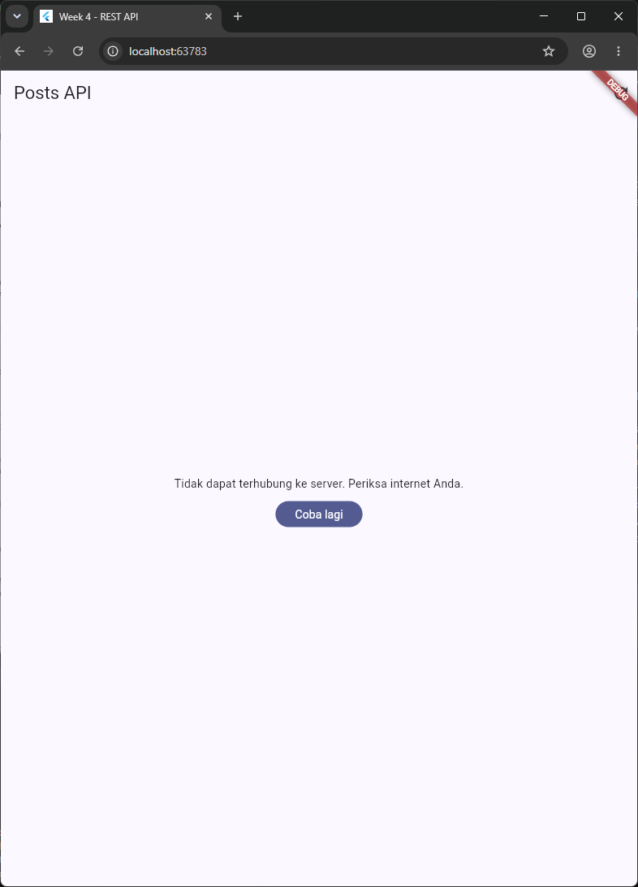
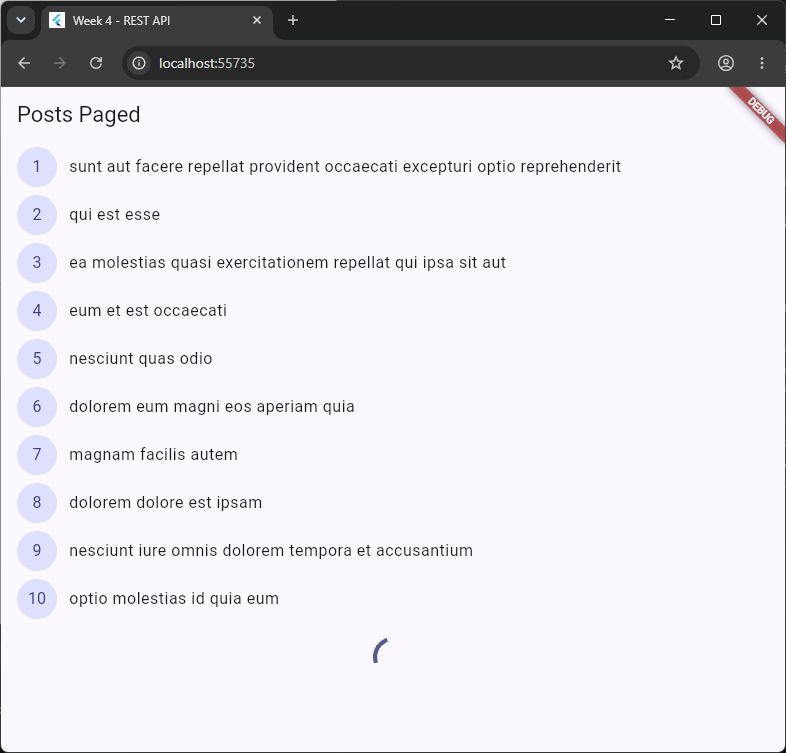
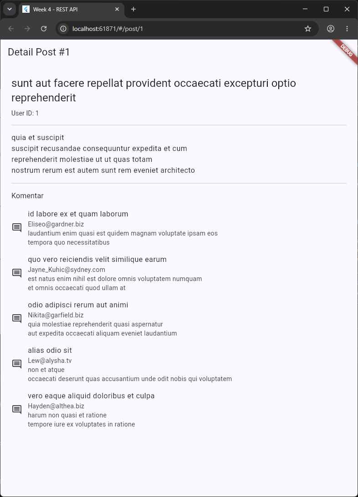

# Laporan Praktikum Minggu 4: Networking & REST API
> **Mata Kuliah:** Pemrograman Mobile | **Semester:** 5

---

### Identitas Mahasiswa
| Data | Keterangan |
| :--- | :--- |
| **Nama Lengkap** | Bintang Pancahaya P |
| **NIM** | 244107020115 |
| **Kelas** | TI-3F |
| **Program Studi** | D-IV Teknik Informatika |
| **Jurusan** | Teknologi Informasi |
| **Institusi** | Politeknik Negeri Malang |

Proyek: `week4_api/` - aplikasi daftar posts dari JSONPlaceholder dengan Dio + Riverpod. Dijalankan dengan `flutter run` lalu memilih **Chrome**.

---

## Praktikum 1: Dio dan Model Data

Model `Post` (`lib/data/models/post.dart`) memakai `fromJson` aman null (`as num?` / `as String? ?? ''`) agar respons API yang tidak lengkap tidak menyebabkan crash. Seluruh konfigurasi jaringan (base URL JSONPlaceholder, timeout 10 detik, header `Accept`, `LogInterceptor`) terpusat di `createDio()` (`lib/data/api_client.dart`). `PostRepository.fetchPosts()` (`lib/data/repositories/post_repository.dart`) menjadi satu-satunya pintu data `GET /posts`; exception sengaja tidak ditangkap agar naik ke provider.

### Tangkapan Layar Hasil Praktikum
| Daftar 100 Posts Berhasil Dimuat |
| :---: |
|  |
| *ListTile berisi judul + body dengan CircleAvatar ID; data dari `PostRepository.fetchPosts()`* |

---

## Praktikum 2: Provider dan Error Handling

`PostListNotifier` (`AsyncNotifier`, `lib/data/providers.dart`) memanggil repository di `build()`, sehingga exception otomatis menjadi `AsyncError`. `friendlyErrorMessage()` memetakan `DioExceptionType` (timeout, connection error, 404, 401/403, server error) ke pesan Bahasa Indonesia. Halaman `PostListPage` menangani empat state: loading, error + tombol **Coba lagi**, empty, dan success. Retry otomatis Riverpod 3 dimatikan (`retry: null`) agar error langsung final.

Dua skenario error diuji:
1. **Offline** - karena komputer dikendalikan jarak jauh, internet tidak bisa benar-benar dimatikan. Kondisi offline disimulasikan dengan Chrome yang diarahkan ke proxy tak terjangkau untuk host API (`--web-browser-flag=--proxy-server=127.0.0.1:9`), sehingga request gagal dengan `connectionError` seperti mode pesawat.
2. **`baseUrl` salah** - sementara diganti ke `https://jsonplaceholder.typicode.invalid`, lalu dikembalikan setelah uji.

### Tangkapan Layar Hasil Praktikum
| Simulasi Offline | `baseUrl` Salah |
| :---: | :---: |
|  |  |
| *Pesan "Tidak dapat terhubung ke server. Periksa internet Anda." + tombol Coba lagi* | *Pesan koneksi yang sama; `baseUrl` dikembalikan setelah uji* |

---

## Praktikum 3: Pagination Dasar

`PostRepository.fetchPostsPage()` memakai query `?_page=N&_limit=10`. `PagedPostsNotifier` (`lib/data/paged_posts.dart`) menyimpan `items`, `page`, `isLoadingMore`, `hasMore`, dan `error`, dengan guard `if (state.isLoadingMore || !state.hasMore) return;` untuk mencegah request ganda. `PagedPostPage` memakai `ScrollController` yang memicu halaman berikut 200 px sebelum ujung list, dengan indikator di bawah tanpa menghapus data lama.

### Tangkapan Layar Hasil Praktikum
| Halaman Posts Paged |
| :---: |
|  |
| *Halaman 1 (10 item) tampil dulu, indikator loading di ujung list* |

> Catatan: pada jendela setinggi ini 10 item belum memenuhi layar, sehingga halaman berikutnya baru dimuat setelah pengguna scroll ke bawah.

---

## AI Prompt Challenge

```text
Buatkan repository layer Flutter untuk endpoint GET /comments?postId={id}
dari JSONPlaceholder menggunakan Dio + flutter_riverpod.
Requirements:
- Model Comment dengan fromJson aman null (postId, id, name, email, body).
- CommentRepository dengan method fetchComments(postId) + timeout 10 detik.
- AsyncNotifierProvider dengan penanganan error otomatis (AsyncError)
  dan fungsi pesan error
  ramah pengguna untuk timeout, connection error, 404, dan 500.
- Satu unit test untuk fromJson dengan field yang hilang.
Jelaskan setiap bagian kode dalam komentar.
```

### Hasil AI Prompt Challenge
| Berkas Hasil | Peran |
| :--- | :--- |
| `lib/data/models/comment.dart` | Model `Comment` + `fromJson` aman null dan aman tipe salah (`_toInt`, `_toStr`) |
| `lib/data/repositories/comment_repository.dart` | `fetchComments(postId)` -> `GET /comments?postId=`; memakai Dio terpusat (timeout 10 detik) |
| `lib/data/comment_providers.dart` | `commentsProvider` (`AsyncNotifierProvider.family` per `postId`) |
| `lib/pages/post_detail_page.dart` | Komentar ditampilkan di halaman detail post |
| `test/comment_test.dart` | 4 test: field hilang, tipe salah, mapping 404/500, timeout |

Dokumentasi lengkap: `week4_api/docs/AI_PROMPT.md`.

---

## Refactoring Challenge

### Poin-Poin Refactoring Kode
1. **Widget `PostTile`** (`lib/widgets/post_tile.dart`): baris post diekstrak dari `ListView.builder` agar builder pendek dan widget bisa diuji sendiri.
2. **`network_errors.dart`**: `friendlyErrorMessage` dipindah ke `lib/data/network_errors.dart` dan di-export ulang dari `providers.dart`, sehingga dipakai bersama oleh halaman list, paged, dan detail.
3. **Detail post dengan GoRouter `/post/:id`** (`lib/router.dart`, `lib/pages/post_detail_page.dart`): detail diambil dari list yang sudah dimuat, atau lewat `PostRepository.fetchPost(id)` bila rute dibuka langsung (`flutter run --dart-define=START=/post/1`).
4. **Kepatuhan linter**: `flutter analyze` -> **No issues found!**

### Tangkapan Layar Hasil Refactoring
| Detail Post `/post/1` + Komentar |
| :---: |
|  |
| *Judul, user ID, body lengkap, dan daftar komentar dari `commentsProvider`* |

---

## Pengujian Kode (Testing)

Semua test memakai repository palsu / data lokal, tanpa request HTTP sungguhan.

| File | Test |
| :--- | :--- |
| `test/post_test.dart` (dari modul) | fromJson aman field hilang; friendlyErrorMessage connection error; provider sukses dengan repository palsu; provider error dengan repository palsu |
| `test/comment_test.dart` | Comment.fromJson field hilang; Comment.fromJson tipe salah; mapping 404 dan 500; mapping timeout |
| `test/widget_test.dart` | PostTile menampilkan id, title, body dan bisa diketuk |

Hasil: **9/9 test lolos** (`flutter test` -> All tests passed!).
```text
Analyzing week4_api...
No issues found!
```

---

## Checklist Verifikasi Praktikum

- [x] UI tidak memanggil Dio langsung; semua akses data lewat repository + provider.
- [x] Empat state tampil benar: loading, error (+ retry), empty, success.
- [x] Pagination: data bertambah saat scroll, guard request ganda, indikator akhir data.
- [x] `flutter analyze` tanpa issue dan semua test lulus.
- [x] Hasil AI diverifikasi dan didokumentasikan di `week4_api/docs/`.

---

## Eksplorasi AI Prompt Challenge

| No | Poin Pemeriksaan | Hasil | Temuan & Perbaikan |
| :-: | :--- | :-: | :--- |
| 1 | UI memanggil Dio langsung? | Lolos | Halaman detail hanya memakai `commentsProvider`. |
| 2 | `fromJson` aman null? | **Diperbaiki** | Aman untuk field hilang, tetapi crash bila tipe salah (`"id": "9"` -> `type 'String' is not a subtype of type 'num?'`). Ditemukan oleh edge case tambahan; diperbaiki dengan cek `is num` / `is String`. |
| 3 | Semua `DioExceptionType` dipetakan? | Lolos | Memakai ulang `friendlyErrorMessage` (timeout, connectionError, 404, 500, default). |
| 4 | baseUrl/timeout terpusat? | **Diperbaiki** | Draf AI membuat Dio sendiri di repository; diganti memakai `dioProvider` (`createDio()`). |
| 5 | Test hanya happy path? | **Diperbaiki** | Ditambah edge case tipe salah, mapping 404/500, dan timeout. |
| 6 | `flutter analyze` & `flutter test` | Lolos | No issues found; 9/9 test lulus. |

---

## Refleksi Pembelajaran

### 1. Mengapa UI dilarang memanggil Dio langsung?
Agar logika jaringan, pemetaan error, dan testing terpusat di repository/provider. Bila dilanggar, konfigurasi (base URL, timeout, header) tersebar di banyak widget, pesan error mentah bocor ke pengguna, dan widget tidak bisa diuji tanpa internet.

### 2. Kapan pagination client-side cukup, dan kapan harus pagination server?
Client-side cukup untuk data kecil dan stabil (mis. 100 posts JSONPlaceholder) yang sekali muat lalu dipotong di UI. Pagination server (`_page`/`_limit`) wajib untuk data besar atau terus bertambah (feed, katalog) agar hemat bandwidth, memori, dan halaman pertama cepat tampil.

### 3. Bagaimana exception repository menjadi `AsyncError` tanpa try/catch di widget?
Exception yang dilempar di `build()` `AsyncNotifier` ditangkap Riverpod dan diubah menjadi `AsyncError`, lalu UI cukup memakai `.when(error: ...)`. Try/catch eksplisit tetap dibutuhkan saat state diubah manual, misalnya `refresh()` dan `loadNextPage()` yang ingin mempertahankan data lama ketika gagal.

### 4. Bagian mana dari hasil AI yang diperbaiki?
`fromJson` yang masih crash untuk tipe salah, repository yang membuat Dio sendiri (konfigurasi tidak terpusat), dan test yang hanya menguji field hilang. Ketiganya baru terlihat setelah `flutter test` dijalankan dengan edge case tambahan.

---

## Cara Menjalankan Aplikasi
```bash
cd 04-week-4-networking-rest-api/week4_api
flutter pub get
flutter run            # pilih [2] Chrome
flutter analyze
flutter test
```
