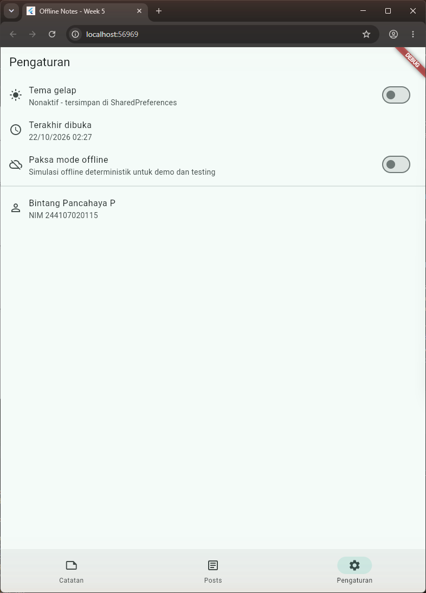
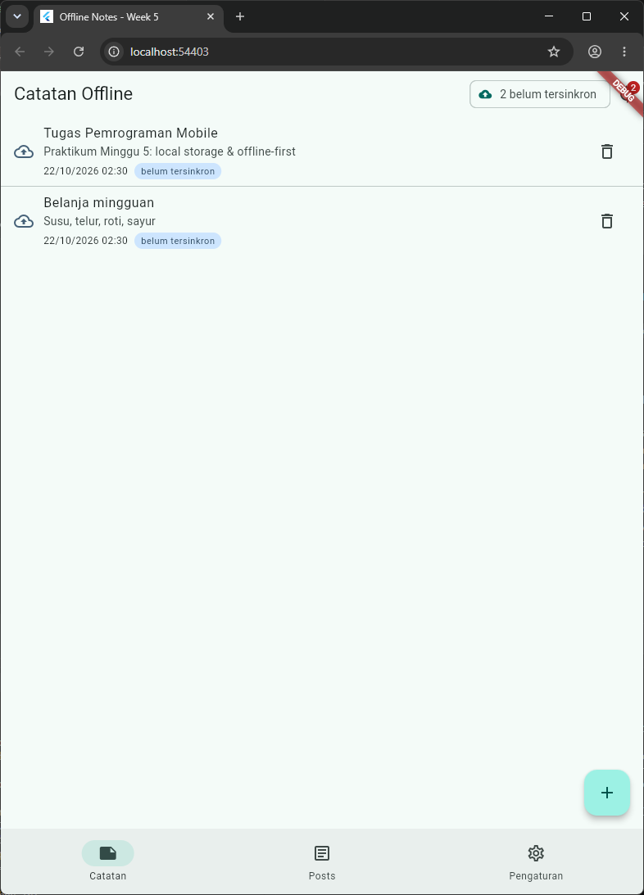
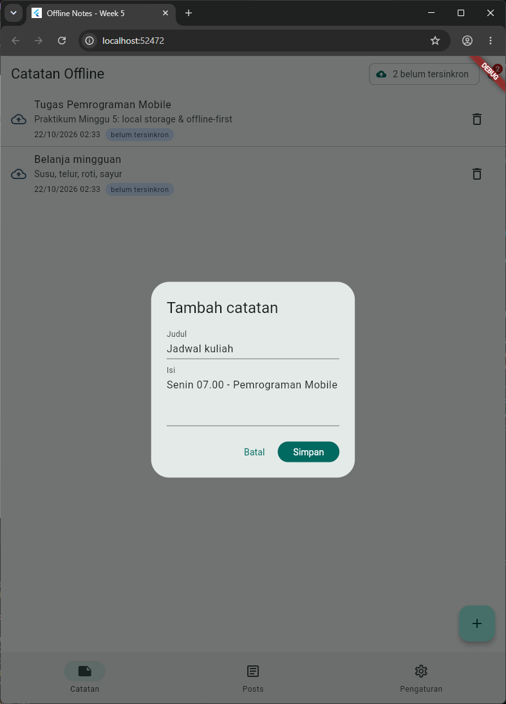
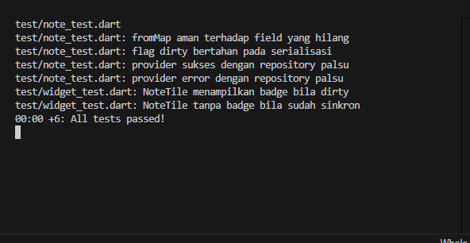

# Laporan Praktikum Minggu 5: Local Storage & Offline-First
> **Mata Kuliah:** Pemrograman Mobile | **Semester:** 5

---

### Identitas Mahasiswa
| Data | Keterangan |
| :--- | :--- |
| **Nama Lengkap** | Bintang Pancahaya P |
| **NIM** | 244107020115 |
| **Kelas** | TI-3F |
| **Program Studi** | D-IV Teknik Informatika |
| **Jurusan** | Teknologi Informasi |
| **Institusi** | Politeknik Negeri Malang |

Proyek: `week5_offline_notes/` - aplikasi Offline Notes (preferensi SharedPreferences + CRUD SQLite + sync offline-first). Dijalankan dengan `flutter run` lalu memilih **Chrome**.

> **Catatan Web:** `sqflite` tidak memiliki implementasi Web. Agar SQLite sungguhan tetap berjalan di Chrome, factory database diganti ke `sqflite_common_ffi_web` (SQLite WASM + IndexedDB) lewat conditional import `lib/data/local/db_factory*.dart`. Di Android/iOS tetap memakai sqflite bawaan; kode repository tidak berubah.

---

## Praktikum 1: SharedPreferences (Tema + Terakhir Dibuka)

Preferensi key-value kecil disimpan lewat `PrefsRepository` (`lib/data/prefs.dart`): `getDarkMode/setDarkMode` dan `markOpenedNow/getLastOpened`. UI tidak memanggil `SharedPreferences.getInstance()` langsung; tema dibaca lewat `darkModeProvider` (`DarkModeNotifier`, `lib/pages/settings_page.dart`) dan waktu dibuka lewat `lastOpenedProvider` yang ditulis sekali saat `HomeShell` dibuka.

### Tangkapan Layar Hasil Praktikum
| Pengaturan Tema Terang | Pengaturan Tema Gelap |
| :---: | :---: |
|  |  |
| *Toggle mati, tema terang; "Terakhir dibuka" dari SharedPreferences* | *Toggle menyala, seluruh aplikasi bertema gelap; nilai tersimpan di SharedPreferences* |

---

## Praktikum 2: SQLite dan Repository Catatan

Skema `notes(id, title, body, updated_at, dirty)` dan `cached_posts(id, payload, cached_at)` dibuat oleh `openNotesDb()` (`lib/data/local/db.dart`). Model `Note` (`lib/data/local/note.dart`) memiliki flag `dirty` untuk catatan yang belum tersinkron. `NoteRepository` (`lib/data/repositories/note_repository.dart`) menyediakan `fetchNotes()` (`ORDER BY updated_at DESC`), `addNote()` (`dirty = 1`), `deleteNote()`, `countDirty()`, dan `markAllSynced()`. Constructor menerima `openDb` agar test bisa menyuntikkan database palsu. `NotesPage` hanya membaca `notesProvider` dan `dirtyCountProvider`.

### Tangkapan Layar Hasil Praktikum
| Daftar Catatan (Urut Terbaru) | Dialog Tambah Catatan |
| :---: | :---: |
|  |  |
| *2 catatan dari SQLite, urut `updated_at` DESC, badge "belum tersinkron", chip "2 belum tersinkron"* | *Dialog Tambah catatan: Judul + Isi, tombol Batal / Simpan* |

---

## Praktikum 3: Cache-First dan Antrean Sync

- **Cache-first (tab Posts):** `CachedPostsNotifier` (`lib/data/sync.dart`) menampilkan isi tabel `cached_posts` seketika, lalu `refreshInBackground()` mengambil `GET /posts` (Dio), menyimpannya ke cache, dan memperbarui UI. Saat offline, cache lama tetap tampil.
- **Sync catatan dirty:** `syncNotes()` (simulasi upload 1 detik lalu `markAllSynced()`), dipanggil tombol sync di AppBar.
- **Offline deterministik:** toggle `forceOffline` (Pengaturan) sesuai saran modul. Saat offline, sync ditunda dan catatan tetap tersimpan lokal.
- **Aturan konflik:** last-write-wins berdasarkan `updated_at` (`week5_offline_notes/docs/aturan-konflik.md`).

### Tangkapan Layar Hasil Praktikum
| Sebelum Sync (Offline, 2 Dirty) | Sesudah Sync |
| :---: | :---: |
|  |  |
| *Chip "Offline" + "2 belum tersinkron"; catatan tetap tampil dari SQLite* | *Chip "Sinkron", ikon awan-centang, SnackBar "2 catatan berhasil disinkronkan"* |

> Catatan pengambilan screenshot: Chrome tidak bisa diklik karena komputer dikendalikan dari jarak jauh. Kondisi tiap screenshot disiapkan oleh `lib/screenshot_main.dart` (`flutter run -t lib/screenshot_main.dart --dart-define=SCENE=...`) yang memanggil repository/provider asli dan fungsi tombol yang sama (`showAddNoteDialog`, `syncNow`), lalu menjalankan `MyApp` yang sama dengan `main.dart`.

---

## AI Prompt Challenge

```text
Aplikasi Flutter Offline Notes: CRUD catatan + preferensi tema.
Bandingkan SharedPreferences, Hive, sqflite (SQLite), dan Drift
untuk dua kebutuhan ini. Requirements:
- Kriteria: kompleksitas query, kebutuhan relasi, reaktivitas (stream),
  type-safety, ukuran boilerplate, dan kemudahan testing.
- Beri rekomendasi final: mana untuk preferensi, mana untuk catatan,
  beserta alasannya dalam 1 tabel.
- Tunjukkan skema tabel/kotak untuk 1000+ catatan.
Jelaskan trade-off setiap pilihan.
```

### Hasil AI Prompt Challenge (Keputusan Final)
| Kebutuhan | Pilihan | Alasan |
| :--- | :--- | :--- |
| Preferensi (tema, terakhir dibuka) | **SharedPreferences** | Key-value kecil, API sederhana, didukung semua platform termasuk Web |
| Catatan (CRUD 1000+, urut `updated_at`, antrean sync) | **sqflite (SQLite)** | Query SQL + index cukup untuk 1000+ catatan tanpa codegen; repository dengan injeksi `openDb` mudah diuji |

Rekomendasi awal AI adalah **Drift** untuk catatan; ditolak karena kebutuhan stream belum ada (cukup invalidasi provider), boilerplate codegen lebih besar, dan modul mewajibkan sqflite. Tabel perbandingan lengkap + skema 1000+ catatan: `week5_offline_notes/docs/AI_PROMPT.md`.

---

## Refactoring Challenge

### Poin-Poin Refactoring Kode
1. **Widget `NoteTile`** (`lib/widgets/note_tile.dart`): baris catatan diekstrak dan menampilkan badge **"belum tersinkron"** bila `dirty == true`.
2. **`lib/data/sync.dart`**: logika cache posts (`PostCache`, `CachedPostsNotifier`) dan `syncNotes` dipindah dari repository agar `NoteRepository` fokus pada CRUD.
3. **Halaman detail `/note/:id` dengan GoRouter** (`lib/pages/note_detail_page.dart`): membaca langsung dari repository lokal (`fetchNote`), bukan dari state halaman list.
4. **Kepatuhan linter**: `flutter analyze` -> **No issues found!**

---

## Pengujian Kode (Testing)

| File | Test |
| :--- | :--- |
| `test/note_test.dart` (dari modul) | fromMap aman field hilang; flag dirty bertahan pada serialisasi; provider sukses dengan `FakeNoteRepository`; provider error dengan `FakeNoteRepository` |
| `test/widget_test.dart` | NoteTile menampilkan badge bila dirty; NoteTile tanpa badge bila sudah sinkron |

Hasil: **6/6 test lolos**, tidak ada test yang menyentuh SQLite sungguhan.

| Hasil Eksekusi `flutter test` |
| :---: |
|  |

```text
Analyzing week5_offline_notes...
No issues found!
```

---

## Checklist Verifikasi Praktikum

- [x] UI tidak memanggil SQLite/SharedPreferences langsung; semua lewat repository + provider.
- [x] Aplikasi berfungsi saat offline: baca, tambah, hapus catatan dari SQLite lokal.
- [x] Badge dirty akurat sebelum/sesudah sync; cache posts tampil tanpa internet.
- [x] `flutter analyze` tanpa issue dan semua test lulus.
- [x] Hasil AI diverifikasi dan didokumentasikan di `week5_offline_notes/docs/`.

---

## Eksplorasi AI Prompt Challenge

| No | Poin Pemeriksaan | Hasil | Temuan & Tindakan |
| :-: | :--- | :-: | :--- |
| 1 | Daftar catatan ditaruh di SharedPreferences? | Lolos | AI hanya memakai SharedPreferences untuk tema; catatan di SQLite. |
| 2 | Skema mendukung antrean sync? | Lolos | Ada `dirty` + `updated_at`, ditambah index `dirty` agar `countDirty()` cepat untuk 1000+ baris. |
| 3 | Klaim "real-time" didukung stream? | **Ditolak sebagian** | Hanya benar untuk Drift (`watch`) dan Hive (`box.watch`). Di sqflite, pembaruan UI dicapai dengan `ref.invalidate(notesProvider)` setelah mutasi. |
| 4 | Estimasi boilerplate masuk akal? | **Dikoreksi** | Drift butuh `drift_dev` + `build_runner` + setup WASM di Web; terlalu optimistis. sqflite cukup `flutter pub add` + `sqflite_common_ffi_web:setup`. |
| 5 | Keputusan final | - | SharedPreferences + sqflite (lihat tabel di atas). |

---

## Refleksi Pembelajaran

### 1. Mengapa daftar catatan tidak boleh disimpan di SharedPreferences?
SharedPreferences hanya untuk key-value kecil. Koleksi harus diserialisasi utuh setiap perubahan, tidak bisa di-query/diurutkan/difilter, rawan rusak saat tulis bersamaan, dan makin lambat seiring data bertambah.

### 2. Kapan cache-first cukup, dan kapan perlu strategi lain?
Cache-first cocok untuk data bacaan yang boleh sedikit basi (artikel, daftar post). Data real-time seperti harga saham atau saldo butuh network-first dengan fallback cache dan penanda "data lama".

### 3. Bagaimana dirty flag menjadi antrean sync tanpa memblokir UI?
Tulisan langsung ke SQLite dengan `dirty = 1` sehingga UI tidak menunggu jaringan; sync berjalan terpisah lalu `markAllSynced()` hanya setelah server sukses. Tabel outbox terpisah diperlukan bila ada operasi ubah/hapus berurutan yang harus diputar ulang sesuai urutan, retry per item, atau banyak perangkat.

### 4. Bagian mana dari rekomendasi AI yang ditolak?
Drift untuk catatan (over-engineering untuk kebutuhan saat ini) dan klaim "real-time" untuk sqflite yang tidak didukung stream.

---

## Cara Menjalankan Aplikasi
```bash
cd 05-week-5-local-storage-offline-first/week5_offline_notes
flutter pub get
dart run sqflite_common_ffi_web:setup   # sekali, untuk SQLite di Chrome
flutter run                              # pilih [2] Chrome
flutter analyze
flutter test
```
