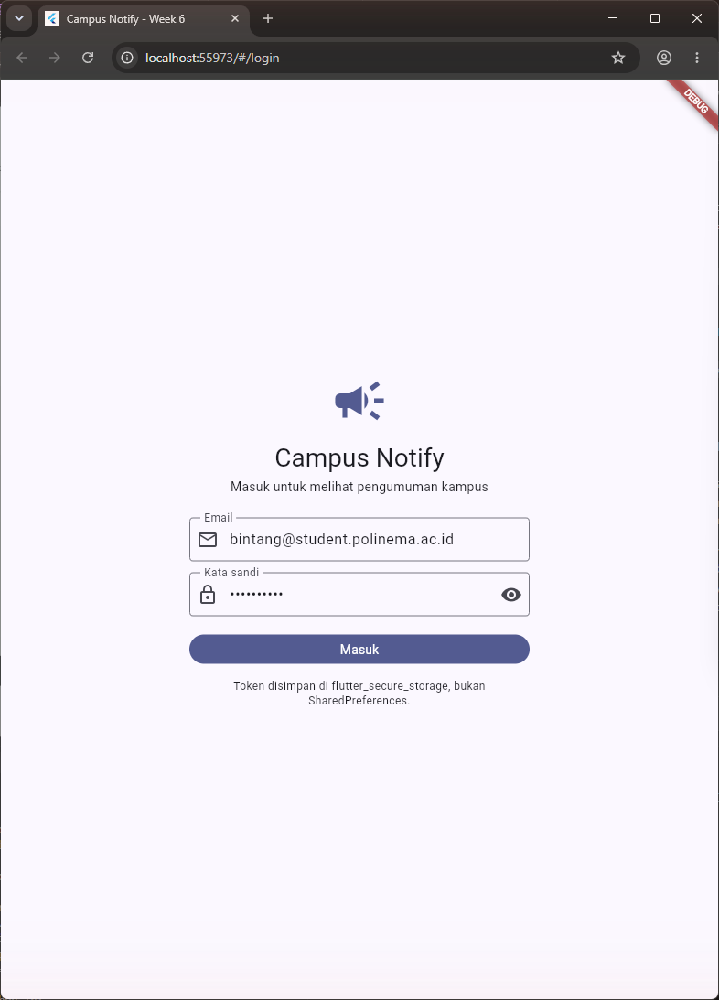
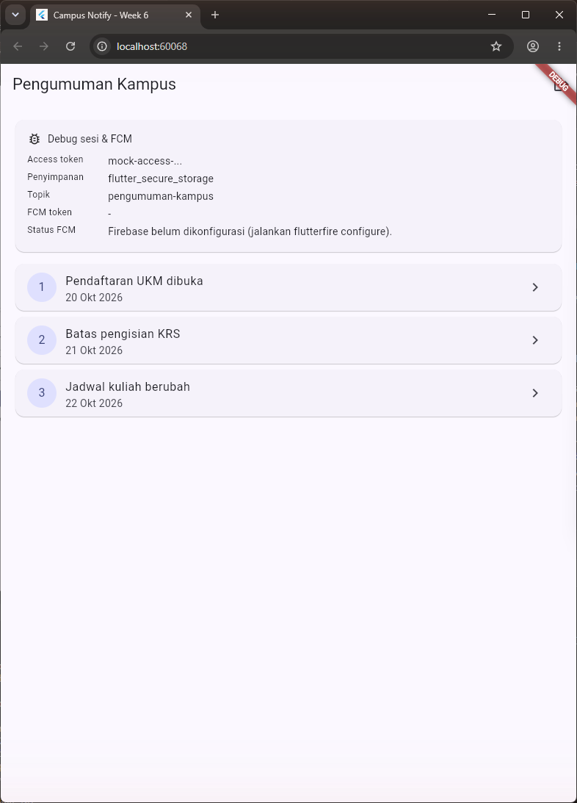
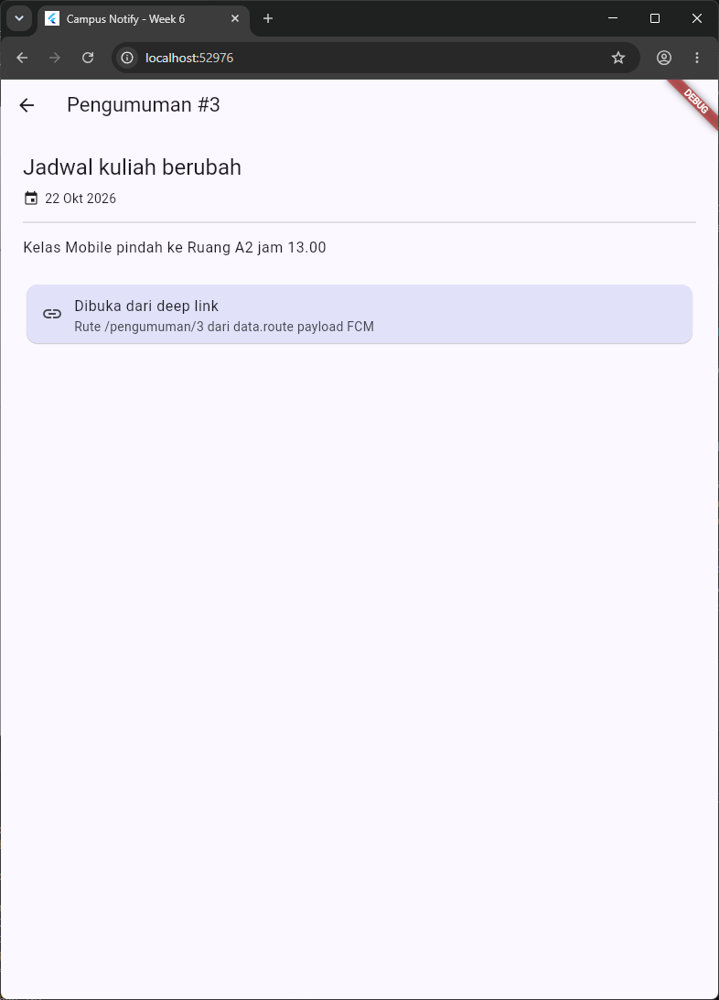
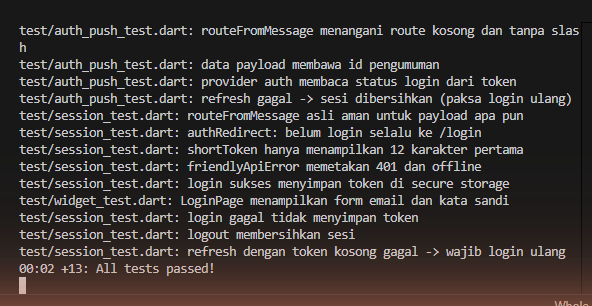

# Laporan Praktikum Minggu 6: Authentication, Security & FCM
> **Mata Kuliah:** Pemrograman Mobile | **Semester:** 5

---

### Identitas Mahasiswa
| Data | Keterangan |
| :--- | :--- |
| **Nama Lengkap** | Bintang Pancahaya P |
| **NIM** | 244107020115 |
| **Kelas** | TI-3F |
| **Program Studi** | D-IV Teknik Informatika |
| **Jurusan** | Teknologi Informasi |
| **Institusi** | Politeknik Negeri Malang |

Proyek: `campus_notify/` - Campus Notification App (login + secure storage + FCM + deep link pengumuman). Dijalankan dengan `flutter run` lalu memilih **Chrome**.

---

## Praktikum 1: Login + Secure Storage + Token Refresh

- **`TokenStore`** (`lib/data/token_store.dart`): access & refresh token hanya keluar-masuk lewat `flutter_secure_storage`, tidak pernah lewat SharedPreferences.
- **`AuthRepository`** (`lib/data/auth_repository.dart`): mock login (email harus mengandung `@`, sandi minimal 6 karakter) yang siap diganti `FirebaseAuth.signInWithEmailAndPassword`.
- **`buildApiClient`** (`lib/data/api_client.dart`): interceptor menambahkan `Authorization: Bearer`, mencoba refresh **sekali** saat 401 lalu mengulang request; bila refresh gagal, sesi di-`clear()` sehingga pengguna kembali ke login.
- **`AuthNotifier` + guard GoRouter** (`lib/providers/auth_provider.dart`, `lib/main.dart`): aturan guard ditulis sebagai fungsi murni `authRedirect()` di `lib/routes.dart`; belum login selalu diarahkan ke `/login`.

### Tangkapan Layar Hasil Praktikum
| Halaman Login |
| :---: |
|  |
| *Form email dan kata sandi terisi, tombol Masuk; token disimpan di flutter_secure_storage* |

---

## Praktikum 2: FCM, Permission, dan Token Lifecycle

`lib/messaging/push_service.dart` berisi `requestNotificationPermission()` (wajib runtime di Android 13+ dan iOS), `initLocalNotifications()`, dan `initFcmToken()`: `getToken()` dikirim ke backend (`POST /devices`), `onTokenRefresh` dipantau agar backend tidak menyimpan token basi, lalu `subscribeToTopic('pengumuman-kampus')`. Kartu debug di beranda hanya menampilkan token **terpotong** (`shortToken`, 12 karakter pertama + `...`).

> **Status Firebase:** project Firebase harus dibuat dengan akun Google pemilik project (`flutterfire configure`), sehingga belum tersedia di sesi ini. `initPush()` mendeteksi `Firebase.apps.isEmpty` dan aplikasi tetap berjalan; kartu debug menampilkan "Firebase belum dikonfigurasi". Langkah aktivasi ada di `campus_notify/README.md`.

### Tangkapan Layar Hasil Praktikum
| Beranda Pengumuman + Kartu Debug |
| :---: |
|  |
| *Access token terpotong, penyimpanan secure storage, topik `pengumuman-kampus`, status FCM, dan 3 pengumuman* |

---

## Praktikum 3: Payload, Tiga App State, Klik dan Topik

- Background handler **top-level** `firebaseMessagingBackgroundHandler` dengan `@pragma('vm:entry-point')` (tanpa BuildContext/Riverpod).
- `listenForeground()`: `onMessage` menampilkan local notification manual (payload = rute), `onMessageOpenedApp` menavigasi ke `data.route`.
- `handleTerminated()`: `getInitialMessage()` dipanggil setelah router siap.
- Payload gabungan `notification` + `data` (`{"route": "/pengumuman/3", "id": "3"}`); rute diambil lewat fungsi murni `routeFromMessage()`.

### Matriks Pengujian Tiga App State
| State | Yang Diharapkan | Cara Uji | Status |
| :--- | :--- | :--- | :--- |
| Foreground | Banner lokal muncul, klik masuk ke `/pengumuman/3` | Aplikasi terbuka, kirim dari console/backend | Logika `routeFromMessage` + payload teruji unit; uji perangkat menunggu Firebase |
| Background | Banner sistem muncul, klik masuk ke rute yang benar | Tekan Home, kirim, klik banner | `onMessageOpenedApp` -> `go(routeFromMessage(data))`; uji perangkat menunggu Firebase |
| Terminated | Aplikasi terbuka ke rute benar via `getInitialMessage` | Tutup aplikasi, kirim, klik banner | `handleTerminated` setelah router siap; uji perangkat menunggu Firebase |

Detail langkah: `campus_notify/docs/matriks-uji.md`.

### Tangkapan Layar Hasil Praktikum
| Detail Pengumuman Tujuan Deep Link |
| :---: |
|  |
| *Payload `{route: /pengumuman/3}` diproses `routeFromMessage` dan membuka `/pengumuman/3`* |

> Catatan pengambilan screenshot: Chrome tidak bisa diklik karena komputer dikendalikan dari jarak jauh. Kondisi disiapkan oleh `lib/screenshot_main.dart`: login memakai `AuthRepository` + `TokenStore` asli, dan scene detail memproses payload contoh modul lewat `routeFromMessage` (fungsi yang sama dengan handler klik notifikasi).

---

## AI Prompt Challenge

```text
Aplikasi Flutter Campus Notification App.
Stack: firebase_messaging, flutter_local_notifications,
flutter_secure_storage, go_router, Riverpod.
Buatkan PushService dengan:
- requestPermission + getToken + onTokenRefresh (kirim ke POST /devices)
- onMessage (tampilkan local notification manual)
- onMessageOpenedApp + getInitialMessage (navigasi ke data.route)
- subscribe/unsubscribe topic pengumuman-kampus
- background handler top-level dengan @pragma('vm:entry-point')
Tandai bagian yang BERBEDA untuk Android 13+ vs iOS,
dan bagian yang tidak boleh mengakses BuildContext.
```

Draf AI dipakai sebagai dasar `push_service.dart` setelah diperbaiki (lihat Eksplorasi AI). Prompt, output awal, dan daftar perbaikan: `campus_notify/docs/AI_PROMPT.md`.

---

## Refactoring Challenge

### Poin-Poin Refactoring Kode
1. **`lib/routes.dart`**: semua string rute (`/login`, `/`, `/pengumuman/:id`) dan topik menjadi konstanta yang dipakai bersama oleh GoRouter dan deep link FCM.
2. **`routeFromMessage(Map<String, dynamic> data)`**: parsing payload menjadi fungsi murni yang bisa diunit-test tanpa Firebase (aman untuk route kosong, tanpa slash, atau bukan String).
3. **`lib/data/api_errors.dart`**: pemetaan `DioException` (401, timeout, offline, server error) ke pesan ramah; UI hanya menerima pesan.
4. **Kepatuhan linter**: `flutter analyze` -> **No issues found!** (`getToken`/`onTokenRefresh` deprecated di firebase_messaging 17 dipertahankan sesuai modul dan diberi komentar).

---

## Pengujian Kode (Testing)

| File | Test |
| :--- | :--- |
| `test/auth_push_test.dart` (dari modul) | routeFromMessage route kosong/tanpa slash; payload membawa id; status login dari token; refresh gagal -> login ulang |
| `test/session_test.dart` (kode asli) | routeFromMessage aman untuk payload apa pun; authRedirect; shortToken 12 karakter; friendlyApiError 401 & offline; login sukses menyimpan token di secure storage; login gagal tidak menyimpan token; logout membersihkan sesi; refresh token kosong gagal |
| `test/widget_test.dart` | LoginPage menampilkan form email dan kata sandi |

Hasil: **13/13 test lolos**, tanpa Firebase sungguhan (secure storage memakai `setMockInitialValues`).

| Hasil Eksekusi `flutter test` |
| :---: |
|  |

```text
Analyzing campus_notify...
No issues found!
```

---

## Checklist Verifikasi Praktikum

- [x] Token hanya di `flutter_secure_storage`, tidak di SharedPreferences, log, atau screenshot penuh.
- [x] 401 memicu refresh sekali lalu retry; refresh mati memaksa login ulang.
- [x] Guard route: belum login selalu diarahkan ke `/login`.
- [x] FCM terstruktur: permission, getToken + onTokenRefresh ke `POST /devices`, subscribe `pengumuman-kampus`.
- [x] Klik notifikasi membuka rute yang benar lewat `routeFromMessage` (teruji unit); uji banner tiap state di perangkat menunggu project Firebase.
- [x] Topik untuk broadcast, token perangkat untuk pesan personal.
- [x] `flutter analyze` bersih dan 13/13 test lulus.

---

## Eksplorasi AI Prompt Challenge

| No | Poin Pemeriksaan | Hasil | Temuan & Perbaikan |
| :-: | :--- | :-: | :--- |
| 1 | Background handler top-level + `@pragma('vm:entry-point')`? | **Diperbaiki** | Draf AI berupa static method kelas; diganti fungsi top-level. |
| 2 | `onTokenRefresh` mengirim token ke backend? | **Diperbaiki** | Draf hanya `debugPrint` (token penuh); diganti `onToken` -> `POST /devices`, tanpa log token. |
| 3 | Foreground memakai local notification manual? | Lolos | Dipertahankan; payload diisi `routeFromMessage(message.data)`. |
| 4 | Klik dari 3 state masuk rute benar? | **Diperbaiki** | Draf navigasi lewat `BuildContext` yang bisa tidak valid saat terminated; diganti callback `go` ke router. |
| 5 | Token/secret tidak di-hardcode/di-log penuh? | **Diperbaiki** | Log dihapus; tampilan hanya `shortToken`. |
| 6 | API plugin sesuai versi? | **Diperbaiki** | `flutter_local_notifications` v22 memakai named parameter (`settings:`, `id:`, `notificationDetails:`). |

---

## Refleksi Pembelajaran

### 1. Mengapa refresh token tidak boleh disimpan di SharedPreferences?
SharedPreferences tidak terenkripsi dan mudah dibaca di perangkat root atau dari backup. Bila refresh token bocor, penyerang bisa terus membuat access token baru tanpa kata sandi sampai token dicabut, sementara pengguna asli tidak menyadarinya.

### 2. Apa yang rusak bila `onTokenRefresh` diabaikan selama satu semester?
Setelah reinstall, hapus data, atau rotasi keamanan, backend tetap menyimpan token lama sehingga pengumuman (mis. jadwal berubah) tidak pernah sampai ke mahasiswa, tanpa ada error yang terlihat.

### 3. Kapan memakai topik dan kapan token perangkat?
Topik untuk broadcast, misalnya "Kuliah libur" ke `pengumuman-kampus` atau info beasiswa satu angkatan. Token perangkat untuk pesan personal, misalnya nilai UTS atau tagihan UKT, karena pesan topik bisa diterima semua pelanggan topik.

### 4. Bagian mana dari draf AI yang ditolak atau diperbaiki?
Background handler di dalam kelas, `onTokenRefresh` yang hanya mencetak token penuh, navigasi lewat `BuildContext`, dan API local notification versi lama. Semua perbaikan tercatat di tabel Eksplorasi AI.

---

## Cara Menjalankan Aplikasi
```bash
cd 06-week-6-authentication-security-fcm/campus_notify
flutter pub get
flutter run        # pilih [2] Chrome
flutter analyze
flutter test
```
Login mock: email apa pun yang mengandung `@` dan kata sandi minimal 6 karakter.
