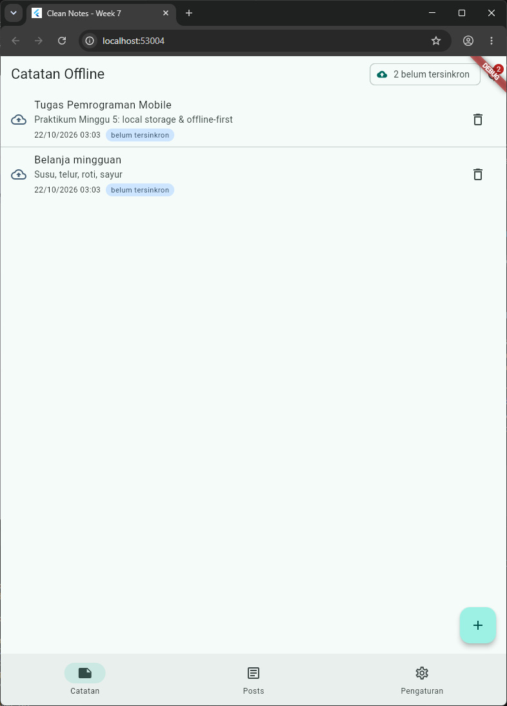
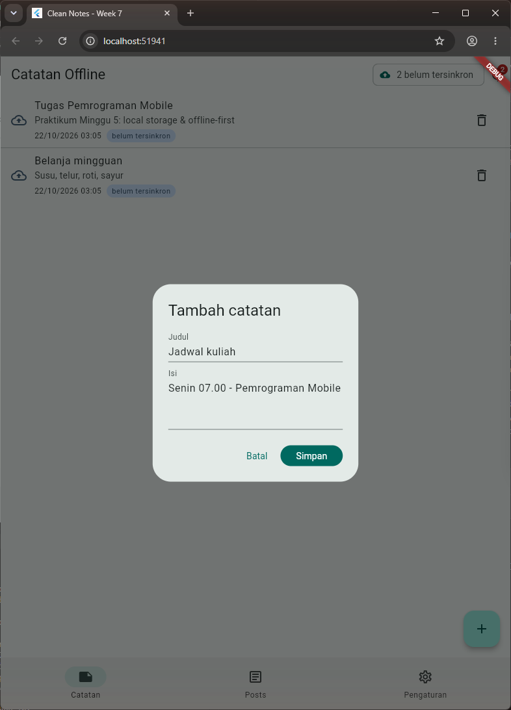
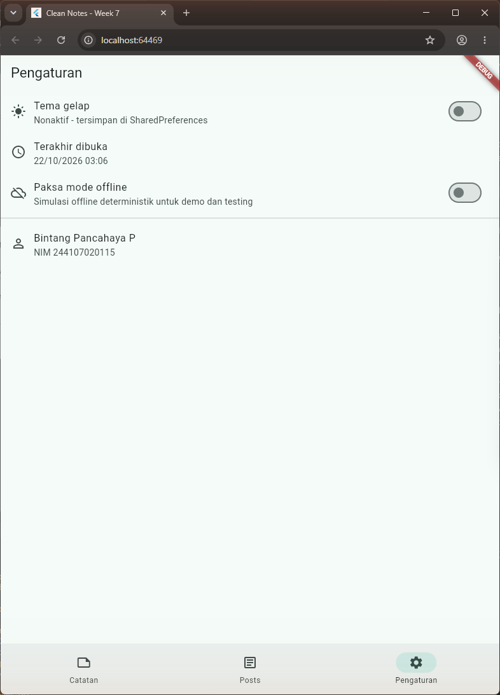
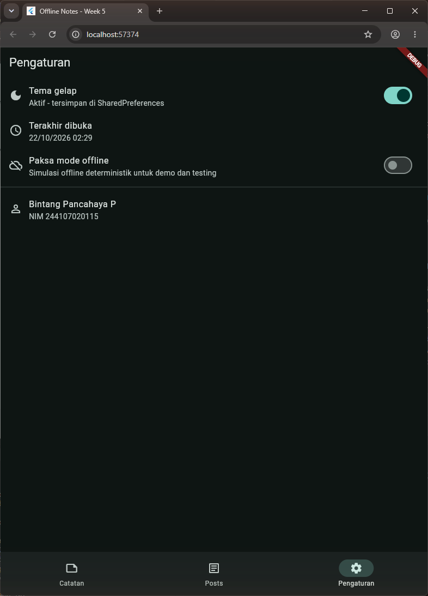
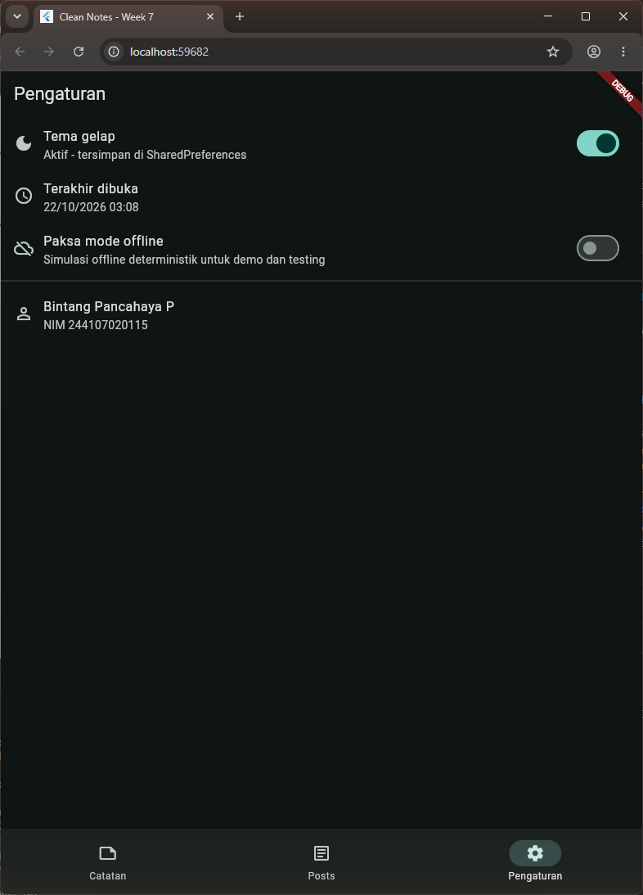
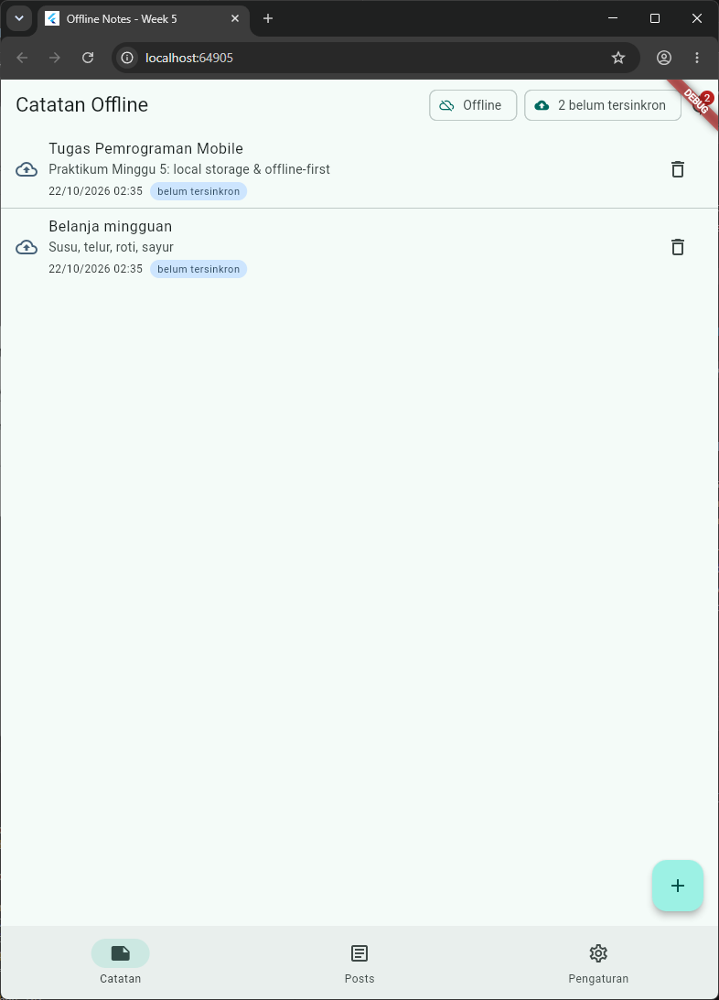
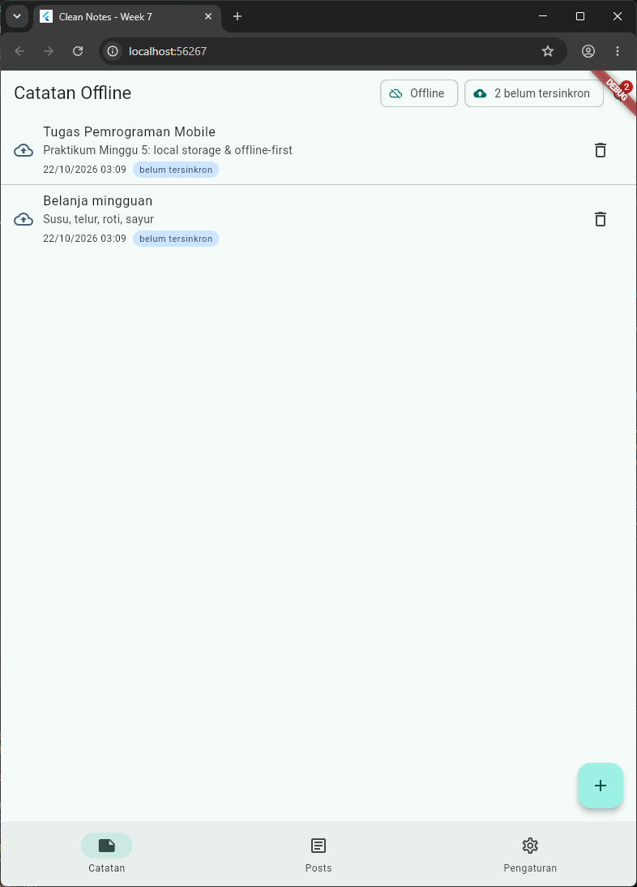
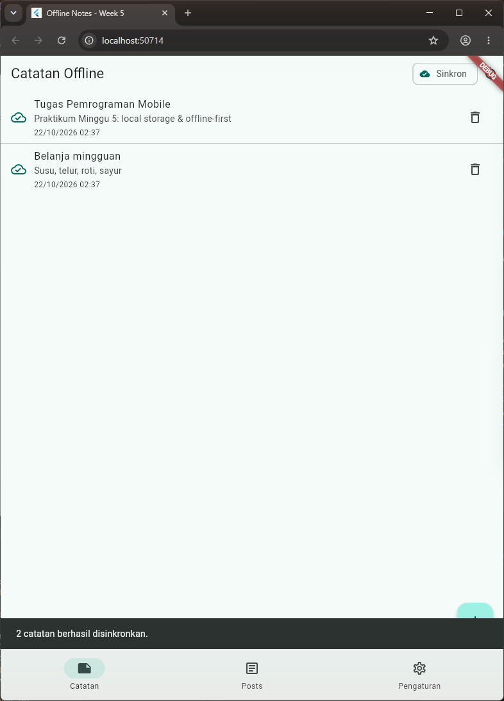
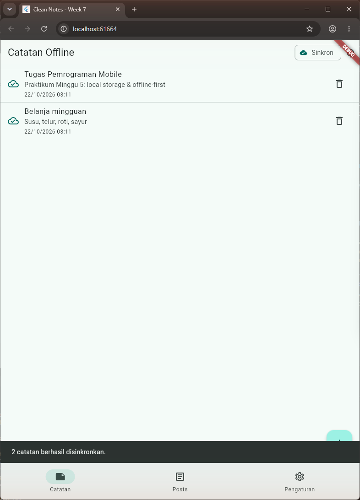
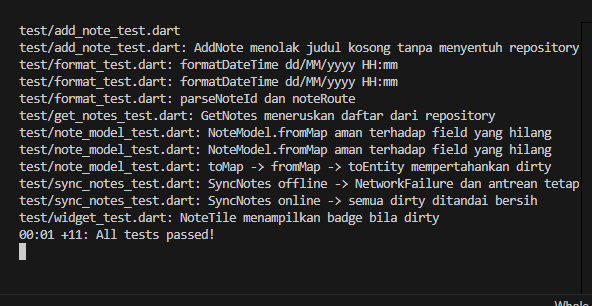

# Laporan Praktikum Minggu 7: Clean Architecture
> **Mata Kuliah:** Pemrograman Mobile | **Semester:** 5

---

### Identitas Mahasiswa
| Data | Keterangan |
| :--- | :--- |
| **Nama Lengkap** | Bintang Pancahaya P |
| **NIM** | 244107020115 |
| **Kelas** | TI-3F |
| **Program Studi** | D-IV Teknik Informatika |
| **Jurusan** | Teknologi Informasi |
| **Institusi** | Politeknik Negeri Malang |

Proyek: folder ini (`07-week-7-clean-architecture/`) adalah hasil refactor **Offline Notes Minggu 5** menjadi Clean Architecture feature-first. Bukan fitur baru: kode yang sudah jalan dipindah dan dipisah per layer, perilaku UI identik. Dijalankan dengan `flutter run` lalu memilih **Chrome**.

---

## Praktikum 1: Audit Layer Project Lama (Minggu 5)

| File lama | Layer saat ini | Masalah | Tujuan baru |
| :--- | :--- | :--- | :--- |
| `pages/settings_page.dart` | presentation | Provider + `PrefsRepository()` dibuat di file halaman (DI bocor) | `features/settings/presentation/{providers,pages}` |
| `data/prefs.dart` | data | Kelas konkret tanpa kontrak | `SettingsRepository` (domain) + `SettingsRepositoryImpl` (data) |
| `data/repositories/note_repository.dart` | data (+ provider) | Interface & implementasi satu kelas; provider presentation di file data | `domain/repositories` (interface) + `data/repositories/note_repository_impl.dart` + `presentation/providers` |
| `data/local/note.dart` | data | Entity sekaligus mapping `toMap/fromMap` | `domain/entities/note.dart` (murni) + `data/models/note_model.dart` |
| `data/sync.dart` | data | Aturan sync + cache posts + provider dalam satu file | Use case `SyncNotes` + fitur `posts` (domain/data/presentation) |
| `pages/notes_page.dart` | presentation | Memanggil fungsi sync/repository lewat container | Hanya membaca state; aksi lewat use case |

Hasil grep audit (`docs/audit-minggu5.txt`): widget menyentuh jaringan/DB = 0, logika bisnis di `build()` = 0, **instansiasi manual** `PrefsRepository()` di `pages/settings_page.dart` = 1, dan kontrak + implementasi tercampur di `prefs.dart`, `sync.dart`, `note_repository.dart`.

### Struktur Target dan Arah Dependensi
```
lib/
├── core/            failures.dart, format.dart            (murni Dart)
├── shared/          database/ (sqflite + factory web), connectivity.dart, widgets/error_view.dart
├── features/
│   ├── notes/       domain (entity, interface, GetNotes/AddNote/SyncNotes) / data (model, impl) / presentation
│   ├── settings/    domain (SettingsRepository, ToggleDarkMode) / data (SharedPreferences) / presentation
│   └── posts/       domain (Post, PostRepository) / data (PostModel, Dio + cache) / presentation
├── app/home_shell.dart
├── routes.dart      GoRouter + konstanta rute
└── main.dart        composition root
```
```
presentation ──► domain ◄── data
      │                       ▲
      └── DI (Riverpod Provider) ┘   hanya provider yang mengenal implementasi
```

---

## Praktikum 2: Domain dan Data per Fitur

- **Entity murni** `Note` (`features/notes/domain/entities/note.dart`) tanpa import Flutter dan tanpa mapping.
- **Failure** (`core/failures.dart`): `sealed class Failure` dengan `LocalFailure`, `NetworkFailure`, dan `ValidationFailure`.
- **Kontrak repository** (`domain/repositories/note_repository.dart`) memakai record Dart `({List<Note> notes, Failure? failure})` agar sukses/gagal eksplisit tanpa exception bocor ke presentation. Kontrak dipecah sesuai **Interface Segregation**: `NoteRepository` (fetch/add, sesuai modul), `NoteEditRepository` (detail/hapus), `NoteSyncRepository` (countDirty/markAllSynced).
- **Model & implementasi** (`data/models/note_model.dart`, `data/repositories/note_repository_impl.dart`): mapping hanya di model, konversi `.toEntity()` di batas data -> domain.
- **Use case** `GetNotes` (modul), `AddNote` (validasi judul + trim), `SyncNotes` (aturan offline + upload + tandai bersih), `ToggleDarkMode` (fitur settings).

### Tangkapan Layar Before / After
| Daftar Catatan - Before (Minggu 5) | Daftar Catatan - After (Minggu 7) |
| :---: | :---: |
|  |  |
| *Struktur lama* | *Struktur Clean Architecture, tampilan identik* |

| Dialog Tambah - Before | Dialog Tambah - After |
| :---: | :---: |
|  |  |
| *`NotesNotifier.add` langsung ke repository* | *Lewat use case `AddNote` (validasi + trim)* |

---

## Praktikum 3: Presentation, DI, dan Verifikasi

Wiring DI terpusat di `features/*/presentation/providers/*_providers.dart`: data layer (`NoteRepositoryImpl(openDb: openNotesDb)`), domain layer (use case menerima abstraksi), dan presentation (`notesProvider`). Halaman hanya membaca state dan menampilkan `failure.message` lewat `ErrorView`; tidak ada SQL, Dio, JSON, atau formatting mentah di widget.

### Verifikasi Dependency Rule (`docs/verifikasi-grep.txt`)
| Pemeriksaan | Hasil |
| :--- | :-: |
| 1. Presentation steril (`Dio(`, `openDatabase`, `getDatabasesPath`, `FlutterSecureStorage`, `SharedPreferences.getInstance`, `jsonDecode`) | **0 hasil** |
| 2. Domain & core steril (`import 'package:flutter/dio/sqflite/firebase`) | **0 hasil** |
| 3. Widget/page tidak menginstansiasi repository | **0 hasil** |
| `flutter analyze` | **No issues found!** |
| `flutter test` | **11/11 lulus** |

Pemeriksaan dijalankan dengan `Select-String` PowerShell memakai pola regex yang sama dengan `rg` di modul.

### Tangkapan Layar Before / After
| Pengaturan Terang - Before | Pengaturan Terang - After |
| :---: | :---: |
|  |  |

| Pengaturan Gelap - Before | Pengaturan Gelap - After |
| :---: | :---: |
|  |  |
| *`DarkModeNotifier` + `PrefsRepository`* | *`ToggleDarkMode` + `SettingsRepository`* |

| Dirty Sebelum Sync - Before | Dirty Sebelum Sync - After |
| :---: | :---: |
|  |  |

| Dirty Sesudah Sync - Before | Dirty Sesudah Sync - After |
| :---: | :---: |
|  |  |
| *Fungsi `syncNotes` di `data/sync.dart`* | *Use case `SyncNotes` di domain* |

> Catatan pengambilan screenshot: screenshot "before" adalah salinan screenshot Minggu 5. Screenshot "after" diambil dengan skenario yang sama melalui `lib/screenshot_main.dart` (Chrome tidak bisa diklik karena komputer dikendalikan dari jarak jauh), yang memanggil provider dan use case asli hasil refactor.

---

## AI Prompt Challenge

Prompt modul ditujukan untuk `campus_notify`; karena project yang direfactor adalah Offline Notes, konteksnya disesuaikan:
```text
Project Flutter saya: week5_offline_notes (catatan SQLite + preferensi + posts cache-first).
Kondisi kini: folder lib/{data, pages, widgets, core},
repository tercampur dengan implementasi, provider dibuat di file halaman.
Tugas:
1. Usulkan struktur feature-first Clean Architecture
   (presentation/domain/data) untuk fitur notes + settings (+ posts).
2. Untuk tiap file lama, sebutkan tujuan barunya (pindah/pecah/hapus).
3. Tandai bagian yang over-engineering bila diterapkan ke CRUD sederhana,
   dan kapan use case benar-benar dibutuhkan vs repository langsung.
4. Tunjukkan wiring DI dengan Riverpod (tanpa package DI tambahan).
Jelaskan trade-off setiap keputusan.
```

### Tabel Usulan AI vs Keputusan Final
| Usulan AI | Keputusan Final | Alasan |
| :--- | :--- | :--- |
| Use case untuk tiap operasi (14 kelas) | Hanya 4: `GetNotes`, `AddNote`, `SyncNotes`, `ToggleDarkMode` | CRUD satu baris (`fetchNote`, `deleteNote`, cache posts) cukup repository langsung ke provider; over-engineering ditolak |
| Satu interface `NoteRepository` gemuk (7 method) | Dipecah: `NoteRepository`, `NoteEditRepository`, `NoteSyncRepository` | Interface Segregation; fake di test modul cukup 2 method |
| `core/database/db.dart` (import sqflite) | Dipindah ke `shared/database/` | `lib/core` wajib bebas sqflite (grep #2) |
| `core/connectivity_provider.dart` (import Riverpod) | Dipindah ke `shared/connectivity.dart` | Pola `import 'package:flutter` ikut menangkap `flutter_riverpod` |
| `get_it` untuk DI | Ditolak | Modul meminta DI dengan Riverpod saja |
| `Dio(BaseOptions(...))` di provider posts | `data/remote/http_client.dart` | Presentation harus 0 hasil untuk `Dio(` |
| Provider melempar `Exception(failure.message)` | Melempar `Failure` + `messageOf()` | UI hanya menerima `message` |

Dokumentasi lengkap: `docs/AI_PROMPT.md`, `docs/keputusan-final.md`, `docs/verifikasi-grep.txt`.

---

## Refactoring Challenge

### Poin-Poin Refactoring Kode
1. **Pola yang sama untuk fitur kedua dan ketiga**: `settings` (entity-less, `SettingsRepository` + impl + use case `ToggleDarkMode` + provider) dan `posts` (entity, `PostRepository` + impl + provider), sehingga tidak ada fitur yang tertinggal "kotor".
2. **Fungsi murni di `lib/core/format.dart`**: `formatDateTime`, `formatDateTimeOrDash`, `noteRoute`, dan `parseNoteId`, teruji tanpa widget.
3. **Exception -> Failure sebelum UI**: repository menangkap exception teknis dan mengembalikan `Failure`; UI menampilkan `failure.message` lewat `ErrorView`/SnackBar.
4. **Kepatuhan linter**: `flutter analyze` -> **No issues found!**

---

## Pengujian Kode (Testing)

Domain diuji murni dengan repository palsu, tanpa SQLite, Dio, atau Firebase.

| File | Test |
| :--- | :--- |
| `test/get_notes_test.dart` (dari modul) | GetNotes meneruskan daftar; GetNotes meneruskan failure tanpa melempar |
| `test/add_note_test.dart` | AddNote menolak judul kosong tanpa menyentuh repository; merapikan input lalu menyimpan sebagai dirty |
| `test/sync_notes_test.dart` | Offline -> `NetworkFailure` dan antrean tetap; online -> semua dirty ditandai bersih |
| `test/note_model_test.dart` | fromMap aman field hilang; `toMap -> fromMap -> toEntity` mempertahankan dirty |
| `test/format_test.dart` | formatDateTime dd/MM/yyyy HH:mm; parseNoteId dan noteRoute |
| `test/widget_test.dart` | NoteTile menampilkan badge bila dirty |

Hasil: **11/11 test lolos**.

| Hasil Eksekusi `flutter test` |
| :---: |
|  |

---

## Checklist Verifikasi Praktikum

- [x] Tiga grep sterilitas (presentation & domain/core) 0 hasil.
- [x] Interface di domain, implementasi di data, mapping hanya di model.
- [x] Widget tidak menginstansiasi repository; semua lewat provider.
- [x] Aplikasi berjalan identik sebelum/sesudah refactor (bukti screenshot before/after).
- [x] `flutter analyze` bersih dan semua test lulus.
- [x] Hasil AI diverifikasi dan didokumentasikan di `docs/`.

---

## Eksplorasi AI Prompt Challenge

| No | Poin Pemeriksaan | Hasil | Temuan & Tindakan |
| :-: | :--- | :-: | :--- |
| 1 | Interface repository di domain, implementasi di data? | Lolos | Diterima sesuai usulan AI. |
| 2 | Domain bebas import Flutter/Dio/SQLite/Firebase? (dicek dengan grep) | **Diperbaiki** | Usulan AI menaruh `db.dart` dan provider Riverpod di `core`; dipindah ke `shared/`. Grep #2 kini 0 hasil. |
| 3 | Use case untuk tiap CRUD satu baris? | **Ditolak** | 14 use case dipangkas menjadi 4 yang punya aturan bisnis. |
| 4 | Entity bebas mapping? | Lolos | `toMap/fromMap/toJson` hanya di `NoteModel`/`PostModel`. |
| 5 | Wiring DI terpusat di provider? | **Diperbaiki** | `Dio(BaseOptions)` dipindah dari provider ke data layer; `get_it` ditolak. |

---

## Refleksi Pembelajaran

### 1. Mengapa interface repository harus di domain, bukan di data?
Domain yang menentukan kebutuhan, data yang menyesuaikan (Dependency Inversion). Bila dibalik, domain ikut bergantung pada data layer (dan sqflite), use case tidak bisa diuji tanpa database, dan mengganti sumber data memaksa domain ikut berubah.

### 2. Kapan use case benar-benar dibutuhkan?
Saat ada aturan bisnis atau gabungan beberapa operasi: `AddNote` (validasi), `SyncNotes` (aturan offline + antrean + tandai bersih), `ToggleDarkMode` (membaca nilai tersimpan). CRUD satu baris cukup repository langsung ke provider.

### 3. Apa biaya over-engineering bagi tim kecil?
Use case per CRUD menambah file, lapisan indirection, dan waktu review tanpa menambah nilai. Biayanya sepadan bila logika tumbuh, dipakai ulang di banyak layar, atau aturan bisnisnya perlu diunit-test.

### 4. Bagian mana dari usulan AI yang ditolak atau disederhanakan?
Use case untuk setiap operasi, interface repository yang gemuk, `core` yang mengimpor sqflite/Riverpod, dan `get_it`. Semua tercatat di tabel usulan vs keputusan final.

---

## Cara Menjalankan Aplikasi
```bash
cd 07-week-7-clean-architecture
flutter pub get
flutter run        # pilih [2] Chrome
flutter analyze
flutter test
```
